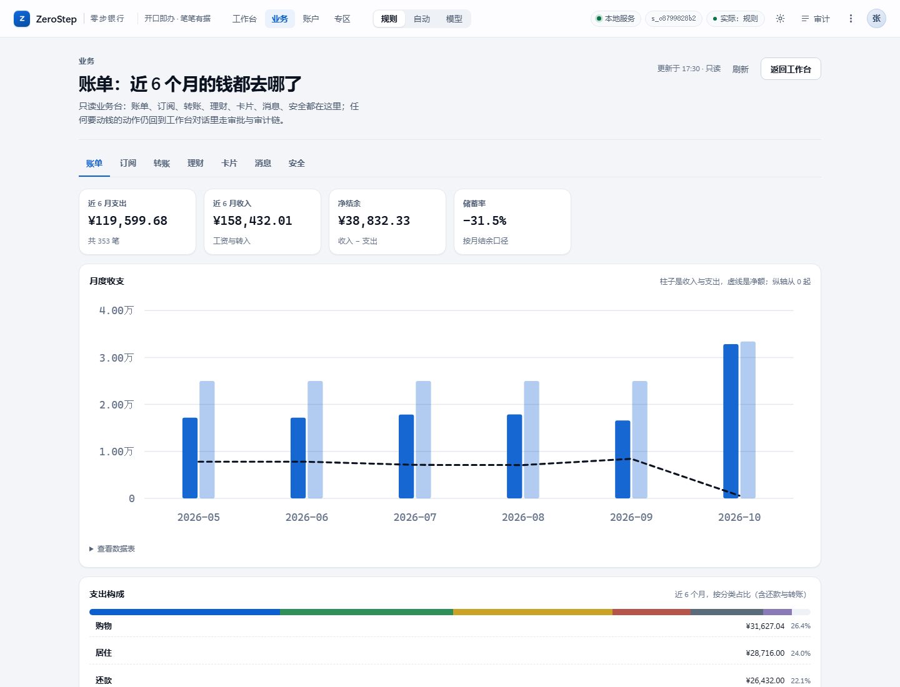
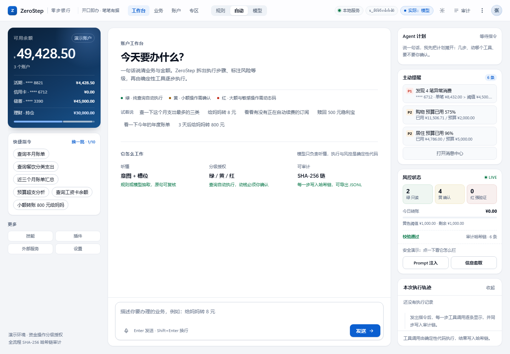
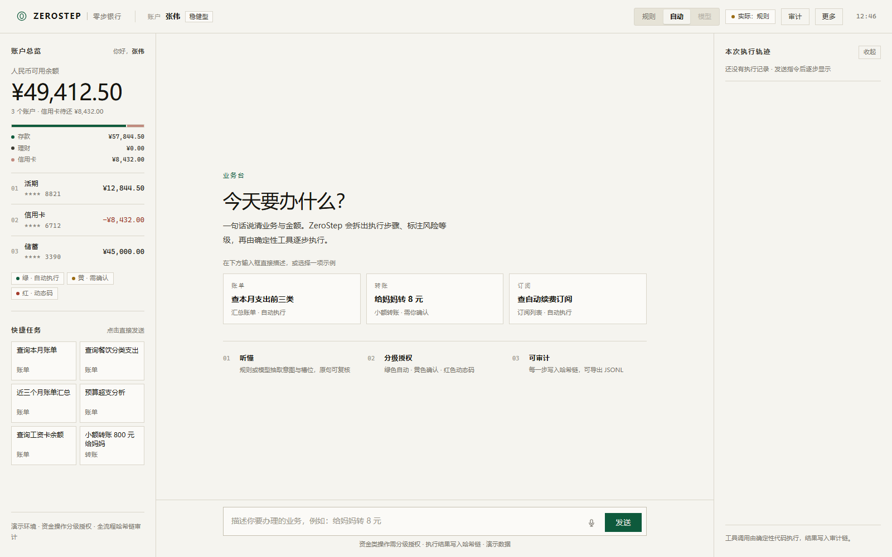
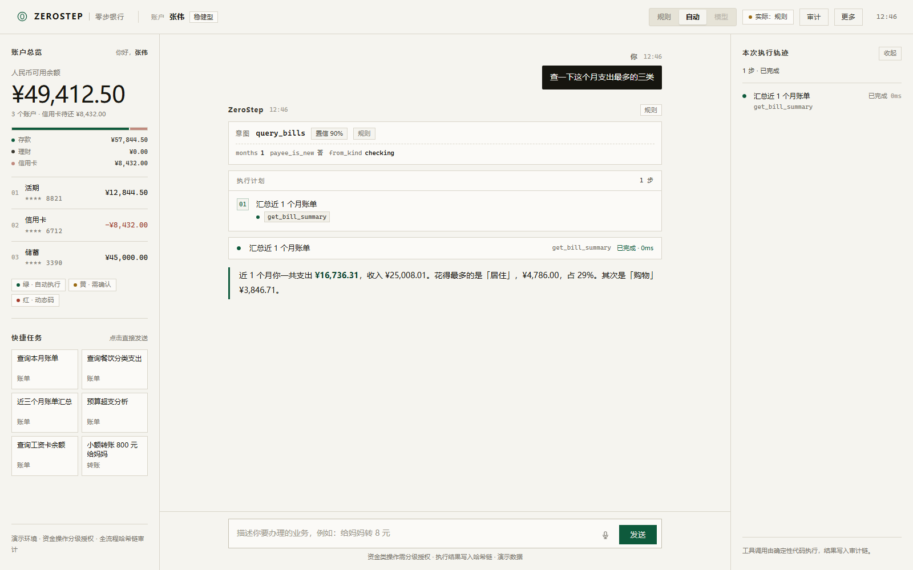
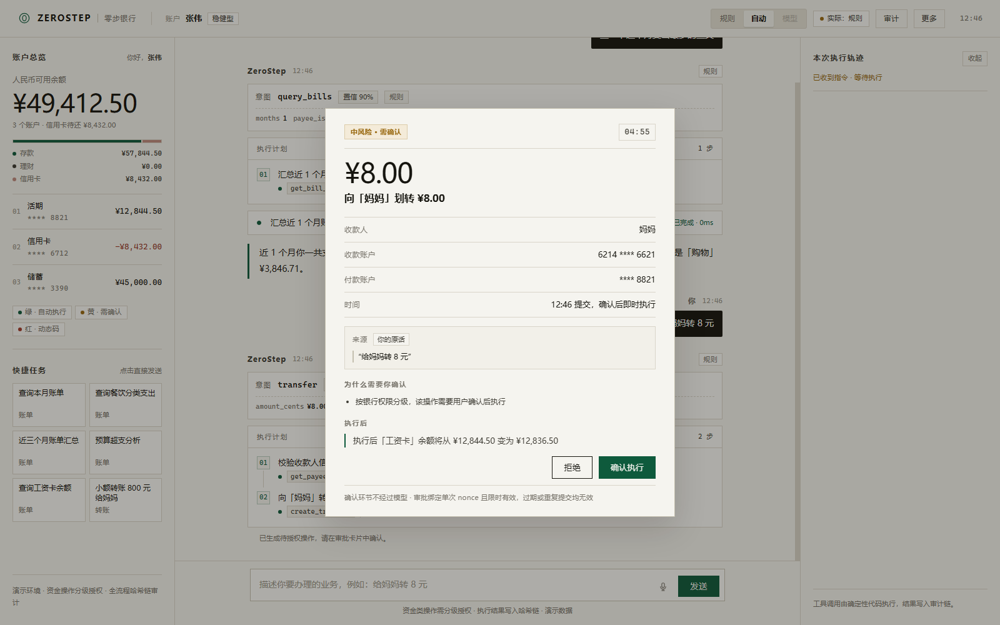
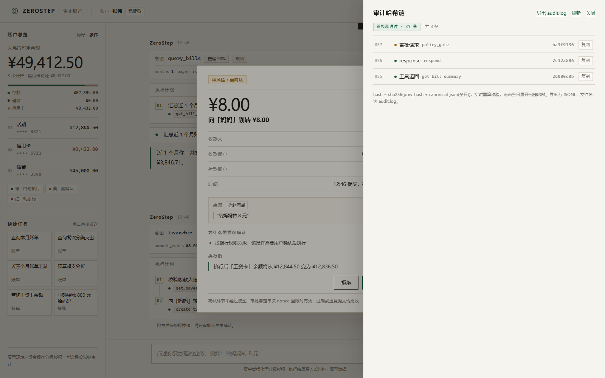
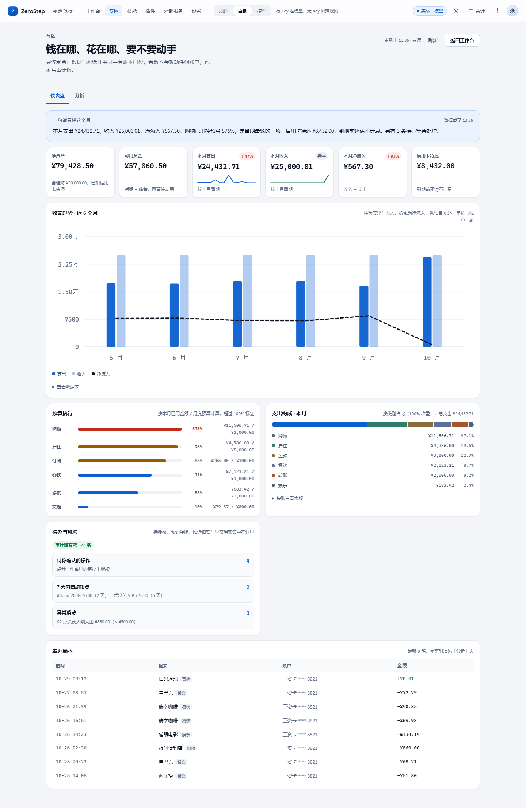
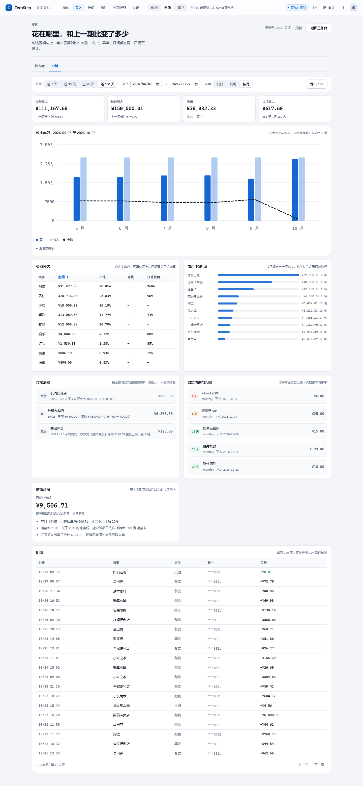
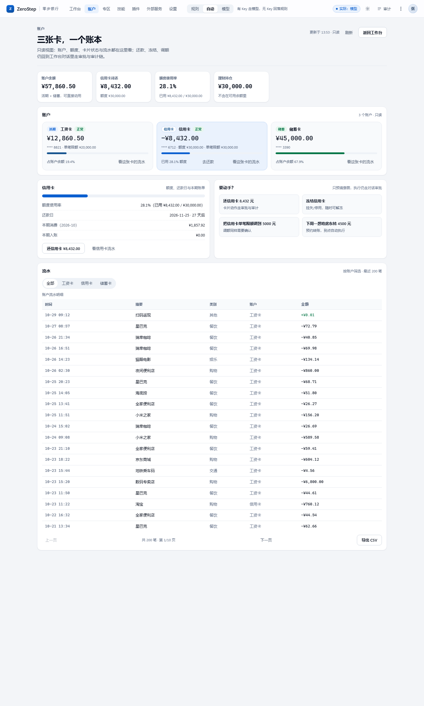

# ZeroStep 零步银行

> **一句话定位：说出来就办好，钱不会乱动。**

ZeroStep（零步银行）是一个面向「手机银行 AI 助手」场景的可运行参考实现：用户用一句自然语言说出需求，Agent 走完「理解 → 规划 → 策略校验 → 执行 → 回读 → 回复」六阶段流水线，把查询、转账、理财、卡片、订阅、跨场景分账真正做完。它同时是一份可被审计、可被评测的工程样本：资金动作全部由确定性工具执行，模型只负责产出意图与槽位，任何高风险动作都必须经过用户确认或强验证因子（TOTP 动态码 / 短信码 / 人脸令牌），连续可疑操作还会临时锁定会话；整条事件链用 SHA-256 哈希链固化。

本仓库为参赛作品（hackathon demo），后端零第三方依赖，仅使用 Python 标准库；当前 v0.8.1：v0.3.0 起把能力拆成 7 个内置插件（核心策略与审计锁定不可停用），v0.3.1 加固模型接入（默认关思考、8 秒超时、10 秒预算、重试与熔断、连接测试），v0.3.2 把渠道做成双向触达（企业微信回调、主动推送、手机端与 PWA），v0.4.0 扩充资金动作并支持预约转账（理财赎回、卡限额、刷卡、异常扫描、年度账单、手机号转账、预约转账），v0.4.1 加固安全边界（挂失/解挂升为红色强验证、TOTP/短信/人脸三因子、连续可疑操作临时锁定会话），v0.5.0 增加消费洞察与订阅识别，并把回答改成可中途停止的逐字流式输出，评测任务 36 → 56 条，规则模式实测 56/56 通过（v0.1.0 基线为 30 条）；v0.5.1 修复操作后账户总览不刷新与资金流向不动（统一 kind 字段口径、理财持仓计入资产构成、回合结束自动刷新快照），用例仍 56/56；v0.6.0 把 MCP 客户端升级为通用网关（MCP_SERVERS 多服务注册表、Bearer / Headers / OAuth2 鉴权、streamable-http 会话与 SSE），并提供银行开放平台演示服务，MCP 仍严格只读；v0.6.1 按全量安全审查收口边界（CORS/Origin/Host 三收紧、演示二次因子接口仅本机、TOTP 改每用户随机密钥、审批 CAS 与会话绑定、转账改单事务、MCP 注册表由替换改为合并、写闸按分词判写、status 脱敏）；v0.6.2 修信用卡还款（新增 `credit_repay` 独立意图与双向记账的 `repay_credit`：默认从工资卡扣款、可指定储蓄卡、金额按欠款截断、无金额/无欠款/余额不足给出拦截文案；评测任务 56 → 59 条）；v0.7.0 在对话工作台之外新增只读「数据专区」——仪表盘（6 KPI + 近 6 月收支 + 预算执行 + 支出构成 + 待办与风险 + 最近流水）与分析页（区间对比、类别排名、商户 TOP10、异常、订阅倒计时、储蓄建议、明细分页与 CSV 导出），并把手写 SVG 图表、hash 路由、外观切换、命令面板 Ctrl+K、骨架屏与无障碍一起补齐；专区只读、不写审计链，评测任务仍为 59 条；v0.7.1 把账户从对话里的一段回答搬成独立一页——账户、额度、卡片状态与流水在一屏看完，付款与改额度仍回到对话走审批；v0.8.0 新增一级导航「业务」（账单/订阅/转账/理财/卡片/消息/安全 七个业务域，只读，动作仍回对话审批），工作台右栏补上 Agent 计划、主动提醒、风控状态与一键攻击演练，并支持三个演示账户切换。

---

## 核心亮点

1. **零依赖、单命令启动**：后端只用 http.server + sqlite3 + 标准库实现 HTTP/SSE 服务，无需 pip install、无需 Node 构建；Python 3.10+ 下执行 python backend/server.py 即可打开完整界面，不配置任何 API Key 也能跑完全部功能。
2. **确定性安全内核**：自然语言只被解析成「意图 + 槽位」，真正的资金变动由 policy 三级闸门与 mock_core 工具执行；模型无法绕过策略门直接改账，越权与注入在进入计划前就被拦截。
3. **大模型接入（三模式）**：解析层真实接入大模型（默认 DeepSeek deepseek-flash，改两个环境变量即可换成任意 OpenAI 兼容服务），支持 rule / llm / auto 三种模式，默认 auto——无 Key 自动回落规则，有 Key 由模型输出意图与槽位；模型输出经严格 schema、金额原文溯源与通讯录匹配校验，攻击判定始终由代码先行，模型不可信、不可授权。
4. **可中断、可恢复**：超过 1000 元或新收款人等高风险动作会挂起为审批态，靠 checkpoint 与 thread_id 持久化上下文，审批 TTL 300 秒；前端关掉再回来仍能继续同一个线程。
5. **可审计、可复盘**：每一次意图、策略决策、工具调用、审批、撤销都写入 events 与 audit 表，审计用 canonical JSON + SHA-256 + prev_hash 组成哈希链，scripts/verify_audit.py 可离线验证链是否被篡改；转账支持 60 秒内撤销，并在写后回读余额做二次校验。
6. **可评测、可扩展**：tasks/ 下 59 条任务（v0.1.0 的 30 条 + v0.2.0 的 t31–t36 + v0.4.0 的 t37–t43 + v0.4.1 的 t44–t46 + v0.5.0 的 t47–t56 + v0.6.2 的 t57–t59）覆盖 9 个类别（账单、转账、理财、卡片、订阅、跨场景、安全攻击、外部服务、消费洞察），scripts/run_tasks.py 一条命令跑完全部断言，v0.6.2 起规则模式与 LLM 模式均实测 59/59 通过（v0.1.0 的 30 条在两种解析模式下均 30/30），并带 --filter、--category、JSON 报告等选项，新增用例只需加一个 JSON 文件。
7. **能力插件化、可启停**：v0.3.0 把核心策略、审计、外部服务、模型通道、技能包、IM 渠道注册为 7 个插件，「插件」页可查看依赖、环境变量、接口与状态并单独启停；核心两项锁定不可停用，任何停用都不会放宽资金边界（policy、审批、TOTP 与哈希链始终生效）。
8. **模型接入加固（v0.3.1）**：默认关闭思考模式，单次超时 8 秒、单轮预算 10 秒、max_tokens 800；空 content 与坏 JSON 重试一次，429/5xx 快速重试，连续 3 次失败熔断 60 秒自动回退规则；设置页「测试连接」与 POST /api/llm/test 可一键验通，status 暴露用量、成本与熔断状态。
9. **全渠道触达与手机端（v0.3.2）**：三种渠道形态（Web / IM webhook / 企业微信回调）共用同一套会话与安全内核；主服务可主动推送订阅扣费、大额支出、还款到期三类提醒并写审计；手机端收口为顶栏 + 底部 tabbar，支持安装为 PWA；企微回调自带验签、AES 解密与 MsgId 去重。
10. **资金动作更完整、预约可审批（v0.4.0）**：新增理财赎回、卡限额调整、刷卡消费、异常交易扫描、年度账单、手机号转账与预约转账 7 类动作；预约创建时审批一次，到期由进程内调度器以幂等键自动执行并写审计；参数级拦截（LIMIT_INVALID / CARD_SINGLE_LIMIT / CARD_DAILY_LIMIT）在执行前给出可解释文案；评测任务增至 43 条（v0.4.1 起为 46 条），规则模式实测 43/43（v0.4.1 起为 46/46）。
11. **红色动作多因子、可疑会话熔断（v0.4.1）**：挂失/解挂从 MEDIUM 升为 HIGH，审批单带 factors=[totp,sms,face]，动态码、短信、人脸任一因子确认即可执行；同一会话 10 分钟内累计 3 次被拦或注入，自动临时锁定 300 秒，锁定检查在解析之前，期间零资金动作，且触发与解锁都写审计。
12. **消费洞察与订阅识别（v0.5.0）**：一句「钱都花哪了」即可拿到近 30 天收支、环比、Top5 分类、可省金额（月/年化）、预算预测与异常明细；detect_subscriptions 在 120 天窗口内按「商户归一 + 相邻间隔 25–35 天 + 金额差 ≤10%」识别周期扣费，演示种子实测识别 10 项，其中 5 项订阅类可省 ¥255.00/月（年化 ¥3,060.00），房租/还款等 5 项固定周期单列、不计入可省。
13. **逐字流式、可随时停止（v0.5.0）**：最终回答按 SSE answer_start → answer_delta ×n（每块 12 字符，块间 ZS_STREAM_DELAY_MS 默认 18ms）→ answer_end → insight_card → done 输出，像真人打字；POST /api/turn/cancel 按 thread_id 停止输出，补 answer_end{cancelled:true} 与「已停止输出」，审计写 answer_cancelled；stream_text=false 时退回旧的整段 message 事件。
14. **洞察只读、建议不代做（v0.5.0）**：洞察计划只有 LOW 只读工具（spending_insights / detect_subscriptions），savings 只是建议（取消订阅、查看账单），任何资金动作仍需用户点按并重新走三级授权；停止输出只作用于文本，不撤销已执行的工具。

15. **操作后总览即刻对齐（v0.5.1）**：账户类型统一按 kind 判断（acctKind），资产构成与账户列表计入理财持仓并单列「理财 · 持仓」一行，回合结束、审批通过与撤销后自动 GET /api/session/{id} 刷新快照；实测 56/56、e2e_stream 33/33、前端自检 247 项全过。
16. **通用 MCP 接入、银行可插拔（v0.6.0）**：MCP_SERVERS 多服务注册表 + Bearer / Headers / OAuth2 鉴权 + streamable-http 会话与 SSE，附带银行开放平台演示服务（8310）验证全链路；只读四道闸把写操作挡在客户端，全局写开关也放不进显式 write_tools——能接更多外部服务，能动钱的边界不变。
17. **边界加固（v0.6.1）**：按全量审查收口——CORS 从 `*` 改为 Origin 白名单、Host 校验防 DNS rebinding、请求体 512 KiB 上限、limit 参数 clamp；演示二次因子接口只接受本机连接；TOTP 每用户随机密钥 + `compare_digest` + 失败锁定；审批改为原子 CAS 并绑定会话与参数摘要；转账改为单事务条件更新，禁负余额；MCP 注册表合并内置 fx/risk、写闸按分词判写、`/api/mcp/status` 脱敏。审查报告保存在本地 `.review/`（三份，未随仓库提交）。
18. **数据专区、只读聚合（v0.7.0）**：新增一级导航「专区」，落地即仪表盘，另含分析页；两个只读接口 `GET /api/dashboard`、`GET /api/analytics` 全部复用对话同一套账本口径，不写资金流水、不写审计链（调用前后 `checked` 不变）。图表是手写 SVG（柱 / 线 / 100% 堆叠 / 环形 / sparkline），按容器宽度出图、键盘可达、每图给表格等价；主题可跟随系统、路由写进 hash、命令面板 Ctrl+K，390 宽无横向滚动。前端自检 247 → 306，新增 `scripts/dashboard_e2e.py` 33/33。
19. **账户页、只读账本（v0.7.1）**：新增一级导航「账户」，一屏看完 4 张 KPI（账户余额 / 信用卡待还 / 额度使用率 / 理财持仓）、三张账户卡（类型徽章、掩码、余额、单笔与日限额、额度占比）、信用卡专区（额度使用率、还款日每月 25 日倒计时、本期消费与入账）、流水（按账户筛选、每页 20 条、CSV 导出）与「要动手？」预填入口；`GET /api/accounts` 顺带补齐卡片字段、`GET /api/transactions` 支持 `account_id` 过滤。页面只读，不写账也不写审计链，任何动钱动作仍走「对话 → 计划 → 审批 → 审计链」。前端自检 306 → 338，`scripts/dashboard_e2e.py` 33 → 39 条断言。
20. **业务页与右栏三卡（v0.8.0）**：新增一级导航「业务」，账单、订阅、转账、理财、卡片、消息、安全七个域各有独立页面并从真实数据渲染（`GET /api/biz` 只读聚合）；工作台右栏常驻 Agent 计划、主动提醒（P1/P2）与风控状态（绿黄红计数 + 今日转账阈值 + 审计链校验），并提供 Prompt 注入 / 信息套取 两个一键演练按钮；`POST /api/demo/identity` 可在张伟 / 李娜 / 王强三个演示账户间切换。前端自检 338 → 363，`dashboard_e2e.py` 39 → 48 条断言。

---

## v0.8.0 新能力（业务页 · 七个业务域 · 右栏三卡）

把「业务」从对话里的一问一答搬成独立界面，同时在对话右栏把 Agent 正在做什么、有什么需要你处理、风险档位在哪，常驻显示出来。

| 能力 | 说明 |
| --- | --- |
| 业务页（`#/biz/<tab>`） | 账单、订阅、转账、理财、卡片、消息、安全七个子页，`GET /api/biz` 一次取全，只读渲染 |
| 账单 | 6 个月支出/收入/净结余/储蓄率、月度收支图与数据表、支出构成（含还款与转账）、预算执行、商户 TOP8 |
| 订阅 / 转账 / 理财 / 卡片 | 订阅按下次扣费倒计时排序；转账含收款人、今日额度与最近转账；理财含持仓与在售产品；卡片含状态、限额与近 30 天消费 |
| 消息 | 按 P1 / P2 排序的主动提醒（异常消费、待审批、信用卡待还、预算超支、临近扣费），每条可一键预填到对话 |
| 安全 | 审计链校验结果、绿黄红三档风控计数、今日额度、二因子因数状态、最近 8 条审计事件、两个攻击演练入口 |
| 右栏三卡 | Agent 计划（执行步骤逐步点亮）、主动提醒（P1 优先）、风控状态（计数 + 阈值 + 链校验）与安全演示按钮 |
| 演示账户 | `POST /api/demo/identity` 切张伟 / 李娜 / 王强，切换后重建会话，业务页与右栏同步换账本 |

v0.8.1 把顶栏收成 4 个主入口（工作台 / 业务 / 账户 / 专区），技能、插件、外部服务、设置移到左栏「更多」；顶栏保留价值语、模式切换、服务状态点、会话号与现实模式，宽屏不再出现控件竖排折行。

边界与 v0.7.x 一致：业务页与右栏只读——不写账、不写 `transactions`、不写审计链；所有动作按钮只把意图预填回工作台输入框，资金操作仍走「对话 → 计划 → 策略 → 审批 → 审计链」。三个演示账户的种子各自独立（`SEED_VERSION` 2026.11.01），切换不会互相污染。

实测（本机，2026-10-29）：`GET /api/biz` 七个域齐全、`messages` 11 条（P1 6 条）、`security.chain.valid=true`；`node frontend/_selftest.js` PASS=363 FAIL=0；`scripts/dashboard_e2e.py` 48/48（新增 `biz-1…biz-9`）；`scripts/run_tasks.py` 59/59 双模式；`scripts/smoke_repay.py` 9/9；`scripts/skill_check.py` 6/6；`scripts/plugin_e2e.py` 17/17。

## v0.7.1 新能力（账户页）

v0.7.0 解决了「看不见全貌」，v0.7.1 解决「账本没有落处」：账户、额度、卡片状态、流水原本散在左栏卡片和问答里，看一眼余额要问一句、查一张卡的额度又要问一句。账户页把这几件事收进一张只读的账本，动钱的部分仍然交给对话。

| 区块 | 内容 | 口径 |
| --- | --- | --- |
| 总览 | 账户余额 / 信用卡待还 / 额度使用率 / 理财持仓 4 张 KPI | 与仪表盘同源：`/api/accounts` + `/api/dashboard` |
| 账户卡 | 工资卡 / 信用卡 / 储蓄卡：类型徽章、掩码后四位、余额、单笔与日限额、占账户余额比例、额度使用条 | `accounts` 项已含 `card_*` 与限额字段 |
| 信用卡专区 | 额度使用率、还款日（每月 25 日）倒计时、本期消费与本期入账、去还款 | 还款日口径与 `push.py` 提醒一致 |
| 流水 | 全部 / 单账户筛选，每页 20 条，上一页 / 下一页，导出 CSV（BOM + CRLF，Excel 直接打开不乱码） | `GET /api/transactions?account_id=` |
| 要动手？ | 还信用卡 / 冻结卡 / 调单笔限额 / 预约转账 四个按钮，把这句话预填进工作台输入框 | 只预填，不执行 |

四条边界：

1. **只读**：页面不调用任何写接口，不产生 transactions / events / audit 记录；`dashboard_e2e.py` 的 `acc-*` 断言与审计链检查在连续取数前后都成立。
2. **不重复定义口径**：余额、额度、账单全部来自后端同一套聚合，前端只负责排版，换账户或换月份不改前端逻辑。
3. **窄屏不砍信息**：≤720px 流水表隐藏「账户」列把宽度让给金额，分页条换行，≤390px 时 KPI 保持两列。
4. **动钱仍走审批**：任何按钮都只往输入框写一句话（例如「还信用卡 8,432 元」），后面仍然是意图 → 计划 → 策略 → 审批 → 审计链。

实测（2026-10-29）：`node frontend/_selftest.js` → PASS=338 FAIL=0；`python scripts/dashboard_e2e.py` → 39/39；`python scripts/run_tasks.py` → 59/59（规则 / LLM 双模式）；1440 浅色 / 1440 深色 / 390 三档截图 `scrollWidth == clientWidth`。

---

## v0.7.0 新能力（数据专区 · 仪表盘 · 分析 · 体验升级）

v0.7.0 解决的是「对话能办事，但看不见全貌」：一句话能查账单，却没人愿意为了看趋势反复问。于是把数据面单独收进一个专区——只读、可下钻、能导出，和对话共用同一套口径，看数不会动账。

| 能力 | 内容 | 文档 |
| --- | --- | --- |
| 仪表盘 | 结论条 + 6 KPI（净资产 / 可用 / 本月支出 / 本月收入 / 本月流入 / 信用卡待还，各带环比与 14 天 sparkline）+ 近 6 月收支 + 预算执行 + 支出构成 + 待办与风险 + 最近流水 | [docs/design-system.md](docs/design-system.md) §七 |
| 分析页 | 7 / 30 / 90 / 180 天与自定义区间、日 / 周 / 月粒度、收支对比、类别排名（可排序）、商户 TOP10、异常消费、订阅倒计时、储蓄建议、明细分页与 CSV 导出 | [docs/api.md](docs/api.md) §4 |
| 只读聚合层 | `backend/app/analytics.py`，复用 mock_core 口径，非法参数 400、未知会话 404，不写 events / audit / transactions | [docs/architecture.md](docs/architecture.md) §15 |
| 图表与无障碍 | 手写 SVG，按容器宽度出图、dpr 适配、tooltip、`aria-label`、表格等价、reduced-motion 落终态 | [docs/design-system.md](docs/design-system.md) §七 |
| 体验升级 | hash 路由、外观切换（系统 / 浅 / 深）、命令面板 Ctrl+K、骨架屏与重试、60 秒可见轮询、CSV 导出 | [docs/design-system.md](docs/design-system.md) §七 |
| 自检 | `scripts/dashboard_e2e.py` 39/39、前端自检 338/338、run_tasks 59/59 | [docs/evaluation.md](docs/evaluation.md) §3.5 |

实测（2026-10-29）：`python scripts/dashboard_e2e.py` → 39/39；`node frontend/_selftest.js` → PASS=338 FAIL=0；`python scripts/run_tasks.py` → 59/59；连续调用 `/api/dashboard`、`/api/analytics` 前后 `/api/audit` 的 `chain.checked` 恒为 22、`valid=true`。

---

## v0.6.0 新能力（通用 MCP 接入 · 银行开放平台）

v0.6.0 把 MCP 从「两个内置演示服务」升级为通用接入：任何符合 MCP 语义的外部服务（含银行开放平台）都能用一段 MCP_SERVERS 配置接入，而资金边界与既有接口语义不变——MCP 仍然只读，审批、TOTP、撤销窗口与审计哈希链照旧。

| 能力 | 内容 | 文档 |
| --- | --- | --- |
| 通用注册表 | MCP_SERVERS（JSON 数组）声明任意多个服务：name / url / transport / tools / write_tools / read_only / timeout / auth；坏配置回退 fx/risk，主流程不受影响 | [docs/mcp.md](docs/mcp.md) |
| 鉴权 | Bearer / 自定义 headers / OAuth2 client_credentials；密钥只写 env:VAR 引用，/api/mcp/status 只回 auth.type 与 configured / token_cached | [docs/mcp.md](docs/mcp.md) |
| streamable-http 会话 | initialize 取 Mcp-Session-Id，后续请求带会话头；text/event-stream 响应按 SSE 解析；会话失效自动重建 | [docs/mcp.md](docs/mcp.md) |
| 银行开放平台演示 | backend/external/bank_mcp_server.py（8310）：Bearer + 会话 + SSE + OAuth2，bank_account_summary / bank_quote 只读，bank_transfer 被主服务与服务端双重拒绝 | [docs/mcp.md](docs/mcp.md) |
| 只读四道闸 | 写操作黑名单先于白名单 → tools 白名单 → tools/list 声明校验；未声明服务/工具在客户端拒绝、零转发，全局写开关也放不进显式 write_tools | [docs/security.md](docs/security.md) |
| 插件与状态 | 每个外部服务自动挂 mcp-<name> 插件（设置页可启停）；/api/mcp/status 增 label / transport / auth / session / read_only | [docs/plugins.md](docs/plugins.md)、[docs/api.md](docs/api.md) |

同时升级：

- 版本号 0.6.0；MCP_SERVERS 为空时行为与 v0.5.1 完全一致（servers 仍是 fx / risk 两项、transport=http），既有接口只加字段、不改语义。
- 演示命令（终端 1 起银行服务，终端 2 起主服务并指向它）：

    python backend/external/bank_mcp_server.py --port 8310 --oauth
    set MCP_SERVERS=[{"name":"bank","label":"演示银行","url":"http://127.0.0.1:8310/mcp","transport":"streamable-http","tools":["bank_account_summary","bank_quote"],"write_tools":["bank_transfer"],"auth":{"type":"bearer","token":"env:BANK_MCP_TOKEN"}}]
    set BANK_MCP_TOKEN=demo-bank-token
    python backend/server.py
    python scripts/mcp_probe.py bank            # 接入真实银行前自检：只读列出 tools/list 并标出写风险工具
    python scripts/mcp_gateway_e2e.py

- 实测（2026-10-28）：scripts/mcp_gateway_e2e.py 17/17；scripts/mcp_probe.py 对演示银行服务 1/1（3 工具，bank_transfer 标写风险）；回归全部 exit 0（run_tasks 56/56、e2e_stream 33/33、capability_e2e 63/63、security_factor_e2e 53/53、plugin_e2e 17/17、mcp_e2e 7/7、selftest 5/5、smoke18 审计链 valid、skill_check 6/6、smoke_normalize 10/10、channel_e2e 9/9、wecom --selftest 9/9、channel_wecom_e2e 13/13、push_e2e 13/13、前端 247/0）。

---

## v0.6.2 修复（信用卡还款）

v0.6.2 修真实用户反馈：「怎么给信用卡还钱」——截图里「把储蓄卡的钱取出 9000 元转移到信用卡」被拦截为「没有识别到合法收款人」。根因是还款没有独立意图（规则先判成 card_query）、`repay_credit` 只把信用卡余额调回 0 却不扣出账账户（凭空造钱）、出账账户不可选且余额不足 / 无欠款不拦截。现在还款是和转账并列的一等意图：`credit_repay` → 单步 `repay_credit`，默认从工资卡扣款，说「用储蓄卡」则从储蓄卡扣，信用卡不能作为出账账户；金额超过实际欠款时按欠款执行；余额不足、已还清、没给金额都给出明确拦截文案。旧话术「还信用卡 8432」在修复前会被判成查卡，提醒推送文案也一并改成与代码一致。

## v0.6.1 修复（接口边界 · 审批绑定 · 资金原子性）

v0.6.1 不增加业务能力，只把全量安全审查（本地 `.review/` 三份报告）发现的问题收口，目标是「默认部署形态」不再能被浏览器里的任意网页或本机其它进程随意驱动，资金操作在并发下也不会超支。

| 问题 | 修复 | 位置 |
| --- | --- | --- |
| CORS `*` + 任意 Origin 可读写接口 | 改为 `CORS_ALLOW_ORIGINS` 白名单（默认只 127.0.0.1/localhost:8000）；带未授权 Origin 的写请求 403；Host 校验防 DNS rebinding | `backend/server.py` |
| 无认证 | 可选 `API_TOKEN`（Header `X-ZeroStep-Token`，默认关闭）；演示模式提示 | `backend/server.py` |
| 演示二次因子自助领取 | `/api/demo/*` 与 `/api/admin/reset` 只接受本机回环连接 | `backend/server.py` |
| TOTP 密钥由公开 user_id 派生、可离线复算 | 每用户随机密钥入库（`totp_secrets` 表）+ `hmac.compare_digest` + 失败 5 次锁 60 秒 | `backend/app/totp.py`、`db.py` |
| 审批不绑会话、可重放 | `check` 校验 `session_id` + 参数摘要；`mark` 改为 `WHERE status='pending'` 的原子 CAS | `backend/app/approvals.py`、`engine.py` |
| 转账读-改-写无事务，可双花/负余额 | `BEGIN IMMEDIATE` + 条件更新（`WHERE balance_cents >= ?`），rowcount 不符即回滚 | `backend/app/mock_core.py` |
| `MCP_SERVERS` 替换内置 fx/risk、写闸可被「bank_transfer」绕过 | 注册表改为「内置 fx/risk + 配置项」合并；写闸按分词/驼峰判动词；`/api/mcp/status` 的 url 与错误脱敏 | `backend/app/mcp_registry.py`、`mcp_client.py` |
| 请求体无上限、limit 无边界、500 回显异常 | 512 KiB 上限（413）、limit clamp 1..200（400）、内部错误只回 `INTERNAL_ERROR` | `backend/server.py` |

实测见下方「后端口径」与 [CHANGELOG.md](CHANGELOG.md)。

---

## v0.5.1 修复（账户总览刷新 · 资金流向）

v0.5.1 修的是「操作完了，左边数字没动」：账户类型字段口径、理财持仓入账、操作后自动刷新。只改会话快照与前端展示层，资金边界、1000 元阈值、审批 TTL 300 秒、撤销窗口 60 秒与审计哈希链均不变。

| 问题 | 原因 | 修复 | 文档 |
| --- | --- | --- | --- |
| 信用卡被算成存款、理财段恒 0 | 后端字段是 kind，前端按 type 判断 | app.js:412 新增 acctKind(a) = a.kind || a.type，总额 / 待还 / 资产构成统一口径 | [docs/architecture.md](docs/architecture.md) |
| 申购后看不到持仓 | 资产构成与账户列表只算活期账户 | 读 session.wealth.holding_total_cents 计入理财段，并追加「理财 · 持仓 ¥X」一行（acct__row--wealth） | [docs/architecture.md](docs/architecture.md) |
| 操作后总览不刷新 | 只在首屏取过一次快照 | refreshAccountSnapshot() 在回合结束 / 审批通过 / 撤销后重新 GET /api/session/{id} 并重渲染 | [docs/api.md](docs/api.md) |
| 快照没有理财字段 | session_snapshot 未返回持仓 | engine.py:56 新增 wealth（holding_total_cents 单位分） | [docs/api.md](docs/api.md) |
| 前端静态资源不更新 | sw.js 缓存版本停在 0.3.2 | VERSION 改 0.5.1，activate 阶段清旧缓存 | [docs/architecture.md](docs/architecture.md) |

实测（2026-10-28）：scripts/run_tasks.py 56/56、scripts/e2e_stream.py 33/33、node frontend/_selftest.js PASS=247 FAIL=0（新增 9 条「资金流向与余额刷新」）。

---

## v0.5.0 新能力（消费洞察 · 逐字流式可打断）

v0.5.0 是「看得懂钱花到哪 + 说得像人在打字」批次：新增只读的消费洞察与订阅识别，把最终回答改成 SSE 逐字流式并支持中途停止。资金工具、1000 元阈值、审批 TTL 300 秒、撤销窗口 60 秒与审计哈希链均不变，新增能力全部是增量。

| 能力 | 内容 | 文档 |
| --- | --- | --- |
| 消费洞察 | 意图 insight 规划单步 LOW 工具 spending_insights：近 30 天收支与环比、Top5 分类、可省金额（月/年化）、预算预测、异常与省钱建议；回复 ≤180 字，数字只来自工具返回 | [docs/api.md](docs/api.md) |
| 订阅识别 | detect_subscriptions(window_days=120) 按商户归一 + 间隔 25–35 天 + 金额差 ≤10% 识别周期扣款，标注 registered / sub_id / subscription_like；固定周期扣费进 fixed_cycles 单列，不计入可省 | [docs/api.md](docs/api.md) |
| 逐字流式 | SSE 新增 answer_start / answer_delta / answer_end 与 insight_card，delta 每块 12 字符、i 从 0；stream_text=false 退回整段 message（旧客户端不用改） | [docs/api.md](docs/api.md) |
| 停止输出 | POST /api/turn/cancel 按 thread_id 停止流式输出，返回 {cancelled, emitted_chunks}；补 answer_end{cancelled:true} 与 note「已停止输出」，审计写 answer_cancelled | [docs/api.md](docs/api.md) |

同时升级：

- 版本 0.5.0（VERSION 唯一来源，改后需重启进程生效；/api/health 与插件 version 字段随之一致）。
- 评测 46 → 56 条：新增 t47–t56 共 10 条 insight 用例（统计口径、环比符号、可省公式、零写操作、订阅命中、一次性消费不误报、SSE 事件序、中途取消、取消不撤销工具、LLM 模式洞察）；规则模式实测 56/56 通过、0 失败（2026-10-28 本机）。
- 工具分支 24 → 26（engine._exec_tool 口径）：新增 spending_insights 与 detect_subscriptions，均登记在 LOW_TOOLS、只读、无需审批；意图 ALLOWED_INTENTS 由 23 增至 24（基础 17 + v0.4.0 六类资金能力 + insight），nlu 与 INTENT_ALIASES 补「洞察 / 花费分析 / 钱都花哪了 / 能省 / 订阅在烧钱」等说法。
- 新增脚本 scripts/e2e_stream.py 覆盖流式事件序与取消（起服务、真实 SSE、端口清理），本机实测 33/33；前端自检 206 → 238 项，PASS=238 FAIL=0（v0.5.1 时点为 247）。
- 兼容性：/api/chat 既有字段不变（新增可选 stream_text）；非流式响应仅在 insight 意图新增顶层 insight 字段；SSE 旧客户端仍收到 message + done。
- 界面：回答气泡逐字追加，生成中「发送」变「停止」，点击后消息补「已停止输出」；洞察回答下方新增洞察卡（收支、分类、可省、预算）。

已知限制：洞察只覆盖近 30 天与已入库数据，订阅识别靠启发式规则（间隔与金额容差），可能漏掉金额浮动的会员或把高频固定消费误标为订阅；流式块大小与延时是演示取值，受网络与浏览器渲染影响；取消只停止后续输出，已执行的只读工具与已发出的文本不会回滚。

---

## v0.4.1 新能力（多因子强验证 · 会话锁定）

v0.4.1 是一次安全加固批次，不改资金工具、金额阈值、审批 TTL、撤销窗口与审计链，只把「红色动作怎么确认」和「连续可疑行为怎么办」补上。

| 能力 | 内容 | 文档 |
| --- | --- | --- |
| 挂失/解挂升红 | set_card_status 从 MEDIUM_TOOLS 移入 HIGH_TOOLS；审批单 risk=high，规则 card_status_change（detail 带卡号后四位） | [docs/security.md](docs/security.md) |
| 三因子强验证 | 审批单新增 factors：[totp,sms,face]（仅 high，其余为空数组）；POST /api/approval 可带 method，取 totp / sms / face 任一因子确认，缺省仍是 totp | [docs/api.md](docs/api.md) |
| 因子通道 | 短信 6 位、TTL 120 秒、单次使用、5 次错误作废；人脸返回 fc_ 令牌、TTL 60 秒、一次性；两者都在内存、不写库 | [docs/architecture.md](docs/architecture.md) |
| 会话异常锁定 | 同一会话 10 分钟内累计 3 次被拦（策略拦截或注入），临时锁定 300 秒；锁定检查在解析之前，期间返回 status=locked 且零资金动作 | [docs/security.md](docs/security.md) |
| 演示接口 | GET /api/demo/sms 返回短信码，POST /api/demo/face 返回人脸令牌，均受 DEMO_MODE 控制（关闭时 403） | [docs/api.md](docs/api.md) |

同时升级：

- 版本 0.4.1（VERSION 唯一来源，改后需重启进程生效）。
- 评测 43 → 46 条：新增 t44 挂失强验证、t45 连续被拦锁定、t46 连续注入锁定；规则模式实测 46/46 通过（2026-10-28 本机），前端自检 PASS=206 FAIL=0（v0.4.0 为 190）；QA 的 scripts/security_factor_e2e.py 53/53（环境 4、挂失红 7、method 分发 8、人脸 4、短信 3、TOTP 3、锁定 10、隔离与重置 4、冷却恢复 4、收尾 6）；v0.4.1 全量回归 17 步全部 exit 0、0 FAIL（审计链 valid checked=105、85 个冻结文件 SHA 前后一致、端口零残留），报告 audit/qa-report-v0.4.1.md（2026-10-28，227 行）建议冻结。
- 新增审计事件 security_locked（risk high）、security_unlocked（risk medium）与 turn_locked（tool=security_lock）；SSE 新增 security_lock；审批通过时 approval_granted 的 result 记录实际使用的 method。
- 新增环境变量 SMS_TTL、FACE_TTL、SMS_MAX_ATTEMPTS、SECURITY_LOCK_THRESHOLD、SECURITY_LOCK_WINDOW_SECONDS、SECURITY_LOCK_SECONDS（见下表）。
- 兼容性：MEDIUM 审批仍是 confirm，只有 challenge=totp 的审批才校验因子；POST /api/approval 不带 method 时行为与 v0.4.0 完全一致。
- 界面：高风险审批卡新增「本次校验方式」三选一（动态码 / 短信 / 人脸），短信演示码可点击填入，人脸令牌显示有效期与过期提示；会话锁定时顶部红色 InfoBar 显示剩余秒数、禁用输入与发送，归零自动恢复（前端自检增至 206 项）。

已知限制：短信码与人脸令牌是内存态，重启或换实例即失效；短信不真的外发、人脸只是令牌不是生物识别；锁定按 session_id 计算，换新会话可绕过，也没有 IP/设备级封禁；多因子是「或」不是「且」，不支持一次要求两种因子；挂失/解挂虽可用短信或人脸，但审批单 challenge 字段仍是 totp。

---

## v0.4.0 新能力（资金动作扩展 · 预约转账）

v0.4.0 在原有查询、转账、理财申购、卡片与订阅之上新增 6 个意图（对外表现为 7 类能力），并把「到点自动执行」做成一次审批、可审计的预约。资金链路、策略门、审批、TOTP 与审计哈希链都不改，新增工具全部走同一个 policy 与同一个审计入口。

| 能力 | 用户怎么说 | 工具 | 风险等级 |
| --- | --- | --- | --- |
| 理财赎回 | 把稳利宝赎回 1000 元 | redeem_wealth | MEDIUM 确认 |
| 卡限额调整 | 信用卡日累计限额调到 5000，单笔 1000 | set_card_limit | MEDIUM 确认 |
| 刷卡消费 | 用信用卡在星巴克消费 35 元 | card_spend | 1000 元内 MEDIUM，超过 TOTP |
| 异常交易扫描 | 帮我看看最近有没有异常交易 | scan_anomalies | LOW 自动 |
| 年度账单 | 2026 年年度账单 | annual_report | LOW 自动 |
| 手机号转账 | 给 13800001111 转 100 元 | create_transfer | 按金额与收款人判定 |
| 预约转账 | 明天上午 9 点给妈妈转 100 元 | create_scheduled_transfer | 1000 元内确认，超过 TOTP |

关键语义：

- 预约转账创建时审批一次，到期由调度器自动执行、不再二次打扰；执行走与手动转账相同的工具与审计，幂等键 sched_<sched_id> 防重复扣款。SCHEDULER_ENABLED=1 默认开启，SCHEDULER_INTERVAL=5 秒检查一次，也可 POST /api/scheduler/tick 手动触发。
- 参数级拦截在规划阶段就给出可解释文案：限额小于等于 0 或单笔大于日累计返回 LIMIT_INVALID；刷卡超单笔 / 超日累计返回 CARD_SINGLE_LIMIT / CARD_DAILY_LIMIT，均不进入执行。
- 只读能力（异常扫描、年度账单、预约列表）自动放行，但同样写事件与审计；手机号转账命中通讯录仍按 payee_known / payee_new / payee_unverified 判定，陌生号码首笔仍需强验证。

同时升级：

- 版本 0.4.0（VERSION 唯一来源，需重启进程生效）。
- 评测 43/43、前端自检 PASS=190 FAIL=0（2026-10-27 本机实测）；QA 全量回归（audit/qa-report-v0.4.0.md，2026-10-27 23:50 冻结批次）全绿：15/15 步 exit 0、0 FAIL，能力端到端 scripts/capability_e2e.py 63/63。
- 种子数据升级：SEED_VERSION 2026.10.29，新增 4 条固定演示异常流水 DEMO_ANOMALY_001..004，收款人补手机号（妈妈 13800001111、房东王姐 13900002222、李明 13700003333），新增 card_txns 与 scheduled_transfers 表。

已知限制：POST /api/scheduler/tick 不接受 body 指定时间；预约只在创建时审批一次；跨场景提醒仍硬编码生日模板；无浏览器像素级验证、?theme=classic 未做。

---

## v0.3.2 新能力（企业微信回调 · 主动触达 · 手机端与 PWA）

v0.3.2 不改资金链路与安全语义，只扩展「消息怎么进来、提醒怎么出去、手机上怎么用」。渠道进程与企微进程都是可选的，不起不影响主服务、Web 页面与 36 条评测。

| 能力 | 内容 | 文档 |
| --- | --- | --- |
| 企业微信回调 | backend/channels/wecom.py + wecom_crypto.py：URL 验签、AES-128-CBC 解密、XML 转发、加密被动回包；默认 8401，MsgId 去重 300 秒 | [docs/channel.md](docs/channel.md) |
| 主动触达 | POST /api/push：subscription / large_txn / repayment 三类提醒，三态 not_configured / delivered / failed，每次写 push_message 审计 | [docs/api.md](docs/api.md) |
| 手机端 | ≤720px 顶栏精简、模式切换移入抽屉、底部 tabbar（工作台/技能/插件/设置，56px + 安全区）、审批弹层按 visualViewport 限高 | [docs/design-system.md](docs/design-system.md) · [docs/channel.md](docs/channel.md) |
| PWA | manifest.webmanifest（standalone、5 个图标含 maskable、theme #0B5FD0）+ sw.js（外壳预缓存、/api/ 永不缓存、导航 network-first 回落；VERSION 0.6.2） | [docs/design-system.md](docs/design-system.md) · [docs/channel.md](docs/channel.md) |
| 模拟推送 | 设置页「模拟推送」卡：三种 kind、一键预览、结果四态，演示环境不真的发短信 | [docs/design-system.md](docs/design-system.md) · [docs/channel.md](docs/channel.md) |

同时升级：

- 版本号 0.3.2：/api/health 与插件 version 字段读取仓库根 VERSION，改后需重启进程生效。
- 实测（2026-10-27 QA 全量回归 audit/qa-report-v0.3.2.md）：15/15 步 exit 0、0 FAIL——企业微信自检 9/9、scripts/channel_wecom_e2e.py 13/13、scripts/push_e2e.py 13/13（含 PWA 静态资源 3 组）、frontend/_selftest.js PASS=182 FAIL=0；36 条业务评测口径不变，基线为 run_tasks 36/36。
- QA 报告结论：全绿、建议冻结 v0.3.2。

---

## v0.3.1 新能力（模型接入加固）

v0.3.1 只动解析层的模型调用，不新增业务动作，也不改策略门、审批、TOTP、审计与资金边界；模型仍然只是不可信的解析器。

| 能力 | 内容 | 文档 |
| --- | --- | --- |
| 关思考、控预算 | DEEPSEEK_THINKING=disabled、DEEPSEEK_TIMEOUT=8、DEEPSEEK_BUDGET=10、DEEPSEEK_MAX_TOKENS=800 | [docs/architecture.md](docs/architecture.md) |
| 重试与熔断 | 空 content / 坏 JSON / 429 / 5xx / 网络超时重试 1 次（退避 600ms）；401/402/403/404/422 不重试；连续 3 次失败熔断 60 秒，冷却期内直接规则解析 | [docs/security.md](docs/security.md) |
| 可观测 | GET /api/llm/status 新增 stats / breaker / degraded / last_error_code / last_error_hint；成本按 tokens 估算 | [docs/api.md](docs/api.md) |
| 连接测试 | POST /api/llm/test 恒 200；真实调用计入用量与熔断统计，唯一不写审计链；设置页「模型接入」卡一键测试并展示用量与熔断状态 | [docs/api.md](docs/api.md) |
| 自检工具 | scripts/llm_stub_server.py 测试桩（已支持 v0.4.0 六类新意图，仅测试用）、scripts/llm_e2e.py 8 场景、scripts/llm_smoke.py 真实 Key 冒烟 | [docs/evaluation.md](docs/evaluation.md) |

同时升级：

- 版本号 0.3.1：/api/health 与插件 version 字段读取仓库根 VERSION，改后需重启进程生效。
- 实测（2026-10-27）：llm_e2e 8/8 场景、52/52 项检查；前端 selftest PASS=134 FAIL=0；run_tasks 36/36；smoke_llm_fallback 6/6、llm_smoke exit 0。正式 QA 报告已出（工作区 audit/qa-report-v0.3.1.md，2026-10-27 22:15）：13 项全绿、0 FAIL。
- 成本量级：按官方空闲时段单价，实测样例单次 ¥0.00056048（0.56 厘），1000 次约 ¥0.56；高峰时段翻倍，约 ¥1.12。

---

## v0.3.0 新能力（插件注册表 · 换一批 · 插件页）

v0.3.0 不新增业务动作，也不改 v0.2.0 的接口语义；它把已有能力显式注册、可观测、可启停，并给首页快捷指令加上分批轮换。

| 能力 | 内容 | 文档 |
| --- | --- | --- |
| 插件注册表 | 7 个内置插件、五类 kind；GET /api/plugins 返回状态与依赖，POST /api/plugins/<id>/toggle 启停；状态写入 PLUGINS_FILE，重启保持 | [docs/plugins.md](docs/plugins.md) |
| 插件页 | 顶栏「插件」入口，2 列卡片：类别、名称、状态徽章（已启用/已停用/降级）、版本、能力 chip、开关与手风琴详情 | [docs/design-system.md](docs/design-system.md) |
| 换一批 | GET /api/tasks 支持 limit/offset/total/has_more；首页快捷指令每批 6 条，「换一批 · x/N」轮换，请求失败回退内置清单 | [docs/api.md](docs/api.md) |
| 停用语义 | core 的 policy/audit 锁定不可停用；mcp 停用走内置降级、intent-llm 停用回规则、skill-pack/channel-im 停用后对应接口返回空或不可用，但资金动作的安全判定不变 | [docs/plugins.md](docs/plugins.md) |

同时升级：

- 版本号 0.3.0（当时 VERSION 值），/api/health 与插件 version 字段读取仓库根 VERSION（改后需重启新进程生效）；当前为 0.6.2。
- 测试（2026-10-27 QA 回归，全部 exit 0）：run_tasks 36/36、plugin_e2e 17/17、smoke18 18/18（审计链 valid，checked=81）、smoke_normalize 10/10、skill_check 6/6、mcp_e2e 7/7、channel_e2e 9/9、verify_audit valid 13 条、前端 selftest PASS=100 FAIL=0。明细见工作区根 audit/qa-report-v0.3.0.md（2026-10-27，212 行，0 FAIL）。

插件状态落盘与演示前检查：

- 状态文件 backend/data/plugins.json，可用环境变量 PLUGINS_FILE 指定路径；POST /api/admin/reset 会把它一并复位，该文件已被 .gitignore 忽略，不进仓库。
- 演示前先看 GET /api/plugins 的 enabled_count 是否为 7（七项均启用）；不是的话在设置页点「全部恢复」或调用 POST /api/admin/reset，再刷新界面。
- 版本号在进程启动时从仓库根 VERSION 读取（v0.3.0 当时为 0.3.0，当前为 0.7.0），改完要重启才生效（已知限制）。

---

## v0.2.0 新能力（MCP · Skill · 渠道 · Win11 界面）

v0.2.0 在 v0.1.0 的安全骨架上补四项能力，铁律不变：安全骨架零回归，已完成的行为只加字段、不改语义；新增外部数据只当数据，只能加严、不能放宽。

| 能力 | 内容 | 文档 |
| --- | --- | --- |
| MCP 外部只读服务 | 汇率 fx_convert、反欺诈 risk_screen；超时 10 秒、连接 2 秒，失败自动降级到内置实现 | [docs/mcp.md](docs/mcp.md) |
| Skill 技能包 | 六张业务卡（转账/账单/理财/卡片/订阅/跨场景）参与规则解析与模型提示词，只影响听懂与规划 | [docs/skills.md](docs/skills.md) |
| IM 渠道适配层 | webhook + 两步确认 + 10 秒幂等 + token 鉴权，回包不带审批凭据；v0.3.2 扩展为双向触达（企微回调 + 主动推送 + 手机端/PWA） | [docs/channel.md](docs/channel.md) |
| 界面 v4 | Win11 Fluent，7 档字号、264/1fr/296 三栏，新增技能页、外部服务页、设置页渠道卡 | [docs/design-system.md](docs/design-system.md) |

同时升级：

- **策略命中可解释**：policy 新增 hits（规则名 + 带数字的 detail），审批卡最多 3 行「为什么需要你确认」。
- **注入防御加固**：NFKC 归一化、零宽字符清洗、同形字映射、去空格紧凑串检测，8 条绕过样本全部检出。
- **新意图 query_fx**：汇率/换汇/兑换类问题规划为单步 fx_convert。
- **评测扩到 36 条**：新增 t31–t36，覆盖外部汇率、外部关闭降级、技能命中、policy hits、注入绕过、账单+提醒跨场景；2026-10-27 全量实测 36/36 通过（规则模式）。

版本号见 VERSION（0.7.0），后端 config.py 从该文件读取且为唯一来源，/api/health 的 version 字段与之一致；变更明细见 [CHANGELOG.md](CHANGELOG.md)。

---

## 界面一览

四态截图（1600×1000，原生 JS，零依赖，无渐变/无外链资源）：

*业务台：余额 hero + 资产构成微条 + 2 列快捷任务，中央三张示例指令*

*一轮对话：意图 chip → 编号执行计划 → 工具 KPI 卡 → 结论卡，右栏竖向执行轨迹*

*审批回单：44px 金额 + 四行发丝表格 + 来源与理由 + 执行后预览 + 单次 nonce 声明*

*审计抽屉：SHA-256 哈希链逐条可校验，可导出 audit.log*

> v0.5.1 起账户区在常规账户行后追加一行「理财 · 持仓」，资产构成按 kind 分活期 / 信用卡 / 理财，回合结束、审批通过与撤销后自动刷新（四张截图摄于 v0.5.0，尚未包含该行）。

*数据专区 · 仪表盘（v0.7.0，1440 宽）：结论条 → 6 KPI（含环比与 14 天 sparkline）→ 近 6 月收支 → 预算执行 → 支出构成 → 待办与风险 → 最近流水*

*数据专区 · 分析（v0.7.0，1440 宽）：区间与粒度筛选 → 区间 KPI → 收支对比 → 类别排名 → 商户 TOP10 → 异常消费 → 订阅倒计时 → 储蓄建议 → 明细分页与 CSV 导出*

*账户页（v0.7.1，1440 宽）：4 张 KPI → 三张账户卡（类型徽章 / 掩码 / 额度占比）→ 信用卡专区（额度使用率、还款日倒计时、本期消费）→ 要动手？预填入口 → 按账户筛选的流水分页与 CSV 导出*

> 专区在 390 宽为单列布局、图表按容器宽度重绘、表格隐藏账户列保住金额列；三档截图均 `scrollWidth == clientWidth`（无横向滚动），深色主题同源换令牌。

---

*业务页（v0.8.0，1440 宽）：七个业务域各一页，全部只读；每块右上角标「只读」与刷新时间，动钱动作只预填意图*

## 架构一览

    浏览器（frontend/ 原生 JS 单页应用）
        │  POST /api/chat（SSE 流式）、POST /api/approval、POST /api/undo
        ▼
    HTTP 层  backend/server.py（http.server，零依赖，含路径穿越防护）
        ▼
    编排层  backend/app/engine.py
        run_turn：lock_check → parse_intent → plan → policy_gate → act → verify → respond
                 parse_intent = llm.parse（按 rule / llm / auto 分派到规则或模型）
        resume  ：审批恢复（checkpoint + thread_id，支持 totp / sms / face）
        ▼
    解析与安全  llm.py（可选模型解析，三模式） · nlu.py（规则解析/攻击识别） ·
                policy.py（三级权限） · approvals.py（审批单/TTL/多因子） ·
                totp.py（RFC 6238） · second_factor.py（短信/人脸） ·
                locks.py（会话异常锁定） · audit.py（哈希链）
        ▼
    领域层  backend/app/mock_core.py（转账/理财申赎/卡限额与刷卡/预约/订阅/提醒，金额整数分）
    调度  backend/app/scheduler.py（每 5 秒检查到期预约，幂等执行并写审计）
        ▼
    存储层  SQLite（backend/data/bank.db）：账户、流水、转账、审批、
            会话、checkpoint、事件、审计链

---

## 快速开始

环境要求：Python 3.10 及以上（CI 覆盖 3.10 与 3.12），无第三方依赖。

    git clone https://github.com/Free-cyber-byte/bank-agent.git
    cd bank-agent
    python backend/server.py

    # Windows 用户也可以直接双击 start.bat：它已内置 chcp 65001 + PYTHONUTF8=1，
    # 中文不会乱码，并自动打开浏览器；默认端口 8000，可用 set PORT=8010 覆盖。
    # 若在旧版 PowerShell 里手动起服务看到乱码，先执行 $env:PYTHONUTF8 = "1"。

服务默认监听 127.0.0.1:8000，浏览器打开 http://127.0.0.1:8000 即可对话。首次启动会自动建库并写入确定性种子数据（SEED_VERSION 2026.10.29：3 个用户、6 个月流水、5 个收款人且含手机号、4 支理财、5 个订阅，另含卡流水与 4 条固定演示异常流水）。

手机访问：用 HOST=0.0.0.0 启动（Windows 可先 set HOST=0.0.0.0），手机与电脑在同一局域网，浏览器打开 http://<电脑局域网IP>:8000。页面在 ≤720px 自动切换为手机布局，可「添加到主屏幕」；PWA 的 Service Worker 只在 localhost 或 HTTPS 下注册，局域网 HTTP 仍可正常使用页面，只是没有离线缓存。

更新后看不到变化：先 Ctrl+F5 强刷；若改的是前端静态资源（app.js / styles.css / index.html），必须同步把 frontend/sw.js 的 VERSION 改成新版本号（当前 0.6.1），否则已安装的 PWA 会继续用旧缓存外壳。

启动后先看两个只读接口，确认版本与插件清单：

    curl.exe -s http://127.0.0.1:8000/api/health
    curl.exe -s http://127.0.0.1:8000/api/plugins

/api/health 返回 version=0.8.0；/api/plugins 返回 count=7、enabled_count=7（未停用时）。界面顶栏出现「插件」入口，首页快捷指令按钮显示「换一批 · 1/10」（59 条任务按每批 6 条分 10 批）。

不需要任何 API Key 也能完整运行：默认的 auto 模式在没有 Key 时等价于规则解析，59 条评测全部通过（规则模式）。想体验模型解析，把 Key 写进仓库根目录的 .env 文件（推荐，已被 .gitignore 排除）即可，界面顶栏可在「规则 / 自动 / 模型」之间切换（「模型」即调用大模型解析，悬停可看到当前厂商与模型名）。

配置模型（二选一，环境变量优先于 .env）：

    # 方式一：.env 文件（推荐，一次配置长期有效）
    copy .env.example .env        # Windows；Linux/macOS 用 cp
    # 用记事本打开 .env，把 DEEPSEEK_API_KEY= 后面填上你的 Key

    # 方式二：临时环境变量（只对当前窗口有效）
    $env:DEEPSEEK_API_KEY = "sk-..."   # PowerShell
    set DEEPSEEK_API_KEY=sk-...        # cmd

Key 只在本机读取，不写入仓库、数据库、事件或审计日志；接口与页面只显示掩码（长度足够时保留前 6 位与后 4 位，否则只留前 2 位）。没有 .env 文件时程序静默跳过，行为与未配置完全一致。

常用环境变量：

| 变量 | 默认值 | 说明 |
| --- | --- | --- |
| PORT | 8000 | HTTP 端口 |
| HOST | 127.0.0.1 | 监听地址 |
| DEMO_MODE | 1（开启） | 设为 0 关闭 /api/demo/totp 等演示接口 |
| DEEPSEEK_API_KEY | 空 | 可选。设置后启用 LLM 解析（默认 auto 模式下生效）；不设置时自动使用规则解析，功能与评测结果不受影响。可写在 .env 中 |
| DEEPSEEK_BASE_URL | https://api.deepseek.com | 可选。OpenAI 兼容接口地址，接入其他兼容服务时只需改这一项 |
| DEEPSEEK_MODEL | deepseek-flash | 可选。模型名，需与接口支持的型号一致 |
| DEEPSEEK_TIMEOUT | 8 | 可选。单次模型调用超时秒数，超时自动回退规则解析 |
| DEEPSEEK_BUDGET | 10 | 可选。单轮解析总预算秒数（含重试等待），超出即回退规则解析 |
| DEEPSEEK_MAX_TOKENS | 800 | 可选。单次输出 token 上限，防止 JSON 被截断 |
| DEEPSEEK_THINKING | disabled | 可选。思考模式开关；默认 disabled 关闭，enabled 开启（更慢更贵） |
| DEEPSEEK_RETRY | 1 | 可选。空 content / JSON 截断 / 429 / 5xx 时的重试次数 |
| DEEPSEEK_RETRY_BACKOFF_MS | 600 | 可选。重试前的等待毫秒数 |
| DEEPSEEK_BREAKER_THRESHOLD | 3 | 可选。连续失败多少次后熔断，熔断期间直接走规则解析 |
| DEEPSEEK_BREAKER_COOLDOWN | 60 | 可选。熔断冷却秒数，冷却结束后自动恢复尝试 |
| ZEROSTEP_DISABLE_LLM | 空 | 设为 1 时即使有 Key 也强制走规则模式 |
| SCHEDULER_ENABLED | 1 | 可选。预约转账调度器开关；设为 0 后预约仍会登记，但不会自动执行 |
| SCHEDULER_INTERVAL | 5 | 可选。调度器检查到期预约的间隔秒数，最小 1 秒 |
| SMS_TTL | 120 | 可选。短信因子有效期秒数（v0.4.1）；演示接口 GET /api/demo/sms 返回的码同此 TTL |
| FACE_TTL | 60 | 可选。人脸因子令牌有效期秒数（v0.4.1）；POST /api/demo/face 返回的 token 同此 TTL |
| SMS_MAX_ATTEMPTS | 5 | 可选。短信码连续错误多少次后作废（v0.4.1），作废后需重新获取 |
| SECURITY_LOCK_THRESHOLD | 3 | 可选。同一会话在窗口内累计多少次被拦后触发锁定（v0.4.1） |
| SECURITY_LOCK_WINDOW_SECONDS | 600 | 可选。统计被拦次数的窗口秒数（v0.4.1，默认 10 分钟） |
| SECURITY_LOCK_SECONDS | 300 | 可选。临时锁定时长秒数（v0.4.1，默认 5 分钟） |

不是只能接 DeepSeek：接口走 OpenAI 兼容协议（POST {base_url}/chat/completions + Bearer + JSON 模式），把 DEEPSEEK_BASE_URL / DEEPSEEK_MODEL / DEEPSEEK_API_KEY 换成对应厂商即可，界面上的厂商与模型名会随之变化。常见示例（仅供填写参考，除 DeepSeek 外未逐一实测，以各厂商文档为准，且对方需支持 JSON 输出）：

| 服务 | DEEPSEEK_BASE_URL | DEEPSEEK_MODEL 示例 |
| --- | --- | --- |
| DeepSeek（默认） | https://api.deepseek.com | deepseek-flash |
| 阿里云百炼（OpenAI 兼容） | https://dashscope.aliyuncs.com/compatible-mode/v1 | qwen-plus |
| Moonshot | https://api.moonshot.cn/v1 | moonshot-v1-8k |
| 智谱 GLM | https://open.bigmodel.cn/api/paas/v4 | glm-4-flash |

想快速感受一次完整交互，可直接跑演示脚本：

    python scripts/replay.py --script scripts/demo_flow.json

### 四进程启动（v0.3.2）：每个进程都可选

v0.3.2 的完整形态是四个进程（主服务、IM 渠道、企微回调、推送接收端），另可选两个外部只读服务（v0.6.0 起还可通过 MCP_SERVERS 接入任意 MCP 服务，内置演示为 8310 的银行服务）；但只有主服务是必需的：单进程 python backend/server.py 就能看到完整界面并办理全部业务。外部 fx/risk 可选，不起时外部服务页显示降级、汇率回落内置参考价、反欺诈评分跳过；IM 渠道可选，不起不影响页面、评测与 CI；企微回调可选，不起只影响企业微信侧；主动推送未配置接收端时只生成文案（not_configured），不阻断任何业务。

| 进程 | 端口 | 是否必需 | 不起时的降级 |
| --- | --- | --- | --- |
| 主服务 backend/server.py | 8000 | 是 | 页面、业务、评测均不可用 |
| IM 渠道 backend/channels/server.py | 8400 | 否 | 设置页渠道卡 enabled=false；Web 与评测不受影响 |
| 企微回调 backend/channels/wecom.py | 8401 | 否 | 企业微信不可达；Web 与主服务不受影响 |
| 外部 fx / risk | 8300 / 8301 | 否 | 汇率回落内置参考价、反欺诈评分跳过，回复标注降级 |
| 推送接收端（CHANNEL_PUSH_URL） | 任意 | 否 | /api/push 返回 not_configured，仅生成文案并写审计 |
| 银行 MCP 演示服务（v0.6.0，可选） | 8310 | 否 | 不配 MCP_SERVERS 即不涉及；配了但服务没起时该服务 status=degraded，其它服务与业务照常 |

    # 终端 1：汇率服务（8300）
    python backend/external/fx_server.py

    # 终端 2：反欺诈服务（8301）
    python backend/external/risk_server.py

    # 终端 3：主服务（8000）
    python backend/server.py

    # 可选：IM 渠道网关（8400）
    python backend/channels/server.py

    # 可选：企业微信回调（8401）；Token/AESKey/CorpID 见 .env.example
    python backend/channels/wecom.py

    # 自检：两服务进程内起停 + JSON-RPC 握手；通用 MCP 接入 17 项；接入前探测
    python backend/external/selftest.py
    python scripts/mcp_e2e.py
    python scripts/mcp_gateway_e2e.py
    python scripts/mcp_probe.py bank
    python scripts/channel_e2e.py

    # 可选：企微回调自检 9/9、端到端 13/13、主动触达 13/13
    python backend/channels/wecom.py --selftest
    python scripts/channel_wecom_e2e.py
    python scripts/push_e2e.py

只起主服务（离线演示推荐）：

    python backend/server.py

此时 GET /api/mcp/status 显示 degraded=true，汇率回落内置表、反欺诈评分跳过；端口可用 --port 覆盖，环境变量 MCP_ENABLED=0 可整体关闭外部调用。手机访问同上：HOST=0.0.0.0 后用局域网 IP 打开。

停止服务（演示结束、换端口、清理残留）：

    # 一键停止 8000 / 8300 / 8301 / 8310（Windows 双击 stop.bat 同理）
    python scripts/stop_services.py

    # 只停指定端口；只看占用了谁，不动手
    python scripts/stop_services.py --ports 8000
    python scripts/stop_services.py --dry-run

脚本按端口找监听进程再结束，结束不了会提示改用任务管理器；不依赖第三方库，Windows 用 netstat + taskkill（被拒时兜底 TerminateProcess），macOS/Linux 用 lsof + kill。手动处理也只要两步：

    # Windows：查占用这个端口的 PID，再结束它
    netstat -ano | findstr :8000
    taskkill /PID <上面查到的PID> /F

    # Windows PowerShell 等价写法
    Get-NetTCPConnection -LocalPort 8000 -State Listen | ForEach-Object { Stop-Process -Id $_.OwningProcess -Force }

    # macOS / Linux
    lsof -ti tcp:8000 | xargs kill

状态检查：

    curl.exe -s http://127.0.0.1:8000/api/mcp/status
    curl.exe -s http://127.0.0.1:8300/health
    curl.exe -s http://127.0.0.1:8301/health
    curl.exe -s http://127.0.0.1:8401/health
    curl.exe -s http://127.0.0.1:8000/api/channel/status

后端口径（逐版本累积）：v0.7.0 新增 `scripts/dashboard_e2e.py`（v0.7.1 增至 39/39、v0.8.0 增至 48/48），回归 run_tasks 59/59（规则 / LLM 双模式）、smoke_repay 9/9、e2e_stream 33/33、skill_check 6/6、plugin_e2e 17/17、push_e2e 13/13、channel_e2e 9/9、mcp_e2e 7/7、smoke18 审计链 valid、verify_audit valid、前端自检 PASS=306 FAIL=0（2026-10-29）；v0.6.1 全量回归 15 项脚本 + 前端自检全部 exit 0（2026-10-28）——mcp_gateway_e2e 19/19、security_factor_e2e 55/55、capability_e2e 63/63、run_tasks 56/56、e2e_stream 33/33、smoke18 18 轮审计链 valid、plugin_e2e 17/17、push_e2e 13/13、channel_wecom_e2e 13/13、skill_check 6/6、smoke_normalize 10/10、mcp_e2e 7/7、selftest 5/5、channel_e2e 9/9、wecom 自检 9/9、前端 PASS=247 FAIL=0；curl 边界自测：恶意 Origin 的 POST/OPTIONS 403、`Host: evil.com` 403、600 KiB body 413、`limit=abc` 400、`limit=-1` 不再全表、无 Origin 的 /api/health 无 ACAO、允许 Origin 回显 + Vary: Origin；v0.6.0 实跑 scripts/mcp_gateway_e2e.py 17/17，回归 run_tasks 56/56、e2e_stream 33/33、capability_e2e 63/63、security_factor_e2e 53/53、plugin_e2e 17/17、mcp_e2e 7/7、selftest 5/5、smoke18 审计链 valid、前端 247/0（2026-10-28）；v0.5.1 实跑 scripts/run_tasks.py 56/56、0 失败（2026-10-28，含 t47–t56）、scripts/e2e_stream.py 33/33、node frontend/_selftest.js PASS=247 FAIL=0（v0.5.0 为 238，v0.4.1 为 206）；v0.4.1 QA security_factor_e2e 53/53、v0.4.1 全量回归 17 步 exit 0、0 FAIL（audit/qa-report-v0.4.1.md，2026-10-28，建议冻结）；历史端点 selftest.py 5/5、scripts/mcp_e2e.py 7/7、scripts/skill_check.py 6/6、scripts/smoke_normalize.py 10/10、scripts/channel_e2e.py 9/9、scripts/plugin_e2e.py 17/17、backend/channels/wecom.py --selftest 9/9、scripts/channel_wecom_e2e.py 13/13、scripts/push_e2e.py 13/13。v0.3.1 QA 回归 13 项全绿；v0.3.2 QA 回归 15/15 步全绿，报告 audit/qa-report-v0.3.2.md 建议冻结；v0.4.0 全量回归（audit/qa-report-v0.4.0.md）17 项全绿、capability_e2e 63/63。server.py 已含 v0.2.0 只读路由、v0.3.0 插件路由、v0.3.2 POST /api/push、v0.4.0 GET /api/scheduled 与 POST /api/scheduler/tick、v0.4.1 GET /api/demo/sms 与 POST /api/demo/face、v0.5.0 POST /api/turn/cancel 与 answer_* 流式事件、v0.6.1 CORS/Host/body/limit/API_TOKEN 边界与演示接口本机限制，字段见 docs/api.md §0 / §2 / §4 / §7。

---

## 大模型接入（三模式）

解析层支持三种模式，可在界面顶栏或通过 POST /api/llm/mode 运行时切换：

| 模式 | 解析方式 | 适用场景 |
| --- | --- | --- |
| rule | nlu.py 规则/正则解析 | 离线演示、可复现评测、无 Key 环境 |
| llm | 调用大模型（默认 DeepSeek deepseek-flash）输出意图与槽位，再经代码层严格校验 | 口语化、开放表达 |
| auto（默认） | 有 Key 用 llm，无 Key 回落 rule | 默认体验 |

接入是真实 HTTP 调用，不是占位：backend/app/llm.py 用标准库 urllib 请求 OpenAI 兼容接口 /chat/completions，默认模型 deepseek-flash，temperature=0、response_format=json_object、单次超时 8 秒、单轮预算 10 秒、max_tokens 800、思考模式默认关闭（均可用环境变量覆盖）。模型只被允许输出一份 JSON：23 个预定义意图之一（含 v0.4.0 的理财赎回、卡限额、刷卡、异常扫描、年度账单、预约转账）、金额、单笔限额、年度、商户、预约时间说法、收款人、月份、品类、产品、订阅、卡、分账列表、提醒与理由；未在原文出现的字段必须为 null，不允许猜测。

三道约束保证模型不影响资金安全：

1. 攻击判定在模型之前：每次解析先走 nlu.detect_attack 的代码规则，命中注入、钓鱼、越权或陌生收款人直接返回 attack，模型不参与判定，也不会被调用。
2. 输出必须过校验：金额必须在原文中找到出处，否则改用规则金额并在审批卡提示冲突；收款人必须命中通讯录或出现在原文；产品、订阅、卡必须匹配种子数据；字段越界一律回退规则值。
3. 风险与动作仍在代码层：模型只产出意图与槽位，build_plan、policy.evaluate、审批、执行、回读、审计全部由确定性代码完成，模型无法决定放行、降低风险或选择工具。

调用失败（网络不可达、超时、返回非 JSON、空 content、字段异常）会自动回退规则解析：空 content 与 JSON 截断重试 1 次，429/5xx 快速重试。这一次真实失败的调用会在事件与审计里记 source=fallback（尝试过模型但失败）；连续 3 次失败后熔断 60 秒，冷却期内的后续请求不再尝试模型，直接规则解析并记 source=rule（根本没调用），同时带 degraded=true。失败原因通过 GET /api/llm/status 的 last_error / last_error_code / last_error_hint 暴露。API Key 只从环境变量读取，不写入数据库、仓库与日志，状态接口只返回脱敏后的 key_masked。

实测（2026-10-27 11:18，deepseek-flash，temperature=0，当时代码超时 12 秒）：30 条标准用例两种模式均 30/30；10 条口语化变体规则听懂 4 条、模型听懂 10 条；安全用例 t26–t30 两种模式均 5/5。v0.3.1 收紧为 8 秒超时并关闭思考模式后，用本地桩跑的 scripts/llm_e2e.py 8/8 场景、52/52 项检查通过（2026-10-27 QA 报告口径），详见「评测」节。完整对比表见「评测」节，接口与字段见 docs/api.md，安全边界见 docs/security.md。

### 模型接入最佳实践（v0.3.1）

**为什么默认关闭思考模式。** 零步银行调用模型只做一件事：把一句中文解析成固定字段的 JSON。这是抽取任务，不需要思维链。DeepSeek 官方文档中思考模式默认开启且 effort=high，开启后模型先生成长段推理再给答案：输出 token 变多、单次耗时变长、费用上升，而 JSON 仍可能被思维链挤占输出预算而截断；此外思考模式下 temperature 不生效，无法用 temperature=0 固定输出。因此 v0.3.1 默认发 DEEPSEEK_THINKING=disabled，需要更强推理时可显式改成 enabled。

**一次解析的预算与失败处理。** 单次 HTTP 超时 8 秒，一次解析（含重试等待）总预算 10 秒；空 content 与 JSON 截断重试 1 次，间隔 600ms，429/5xx 同样快速重试；连续 3 次失败后熔断 60 秒，期间直接走规则解析（intent.source=rule，与真实失败的 fallback 区分），不再付费调用。所有失败最终都回退到 nlu 规则解析，资金动作和审批不受影响。

**成本量级。** 按 DeepSeek 官方空闲时段单价：缓存命中输入 0.02 元/百万 tokens、缓存未命中输入 1 元/百万 tokens、输出 4 元/百万 tokens。本项目 system 前缀固定、技能提示移入 user 消息，同一进程内重复请求更容易命中上下文缓存；一次解析约消耗一两千输入 tokens 与一百左右输出 tokens。

成本公式：

    cost(元) = hit_tokens × 0.02 / 1,000,000
             + miss_tokens × 1.0 / 1,000,000
             + completion_tokens × 4.0 / 1,000,000

真实样例（桩服务实测）：hit=1024、miss=156、completion=96，得 1024×0.02/1e6 + 156×1/1e6 + 96×4/1e6 = ¥0.00056048，即单次约 0.56 厘，1000 次约 ¥0.56。高峰时段（北京时间周一至周五 9:00–12:00、14:00–18:00）单价翻倍，约 ¥1.12；实际费用以账单为准。

**两条自检命令。**

    # 有 Key：真实调用一次，确认 Key、网络、模型名与费用都正常（会产生极小费用）
    python scripts/llm_smoke.py

    # 无 Key：本地起 OpenAI 兼容测试桩，跑 8 个场景（成功/空 content/坏 JSON/429/5xx/超时/熔断/连接测试），不花钱
    python scripts/llm_e2e.py

设置页「模型接入」卡也提供「测试连接」按钮，作用同 POST /api/llm/test：只测连通性与 Key，不写审计链；它仍是一次真实模型调用，会计入进程内 stats 与连续失败计数。v0.3.1 另由 backend-dev 实测：smoke_llm_fallback 6/6、llm_smoke exit 0、run_tasks 36/36；本地复跑（2026-10-27）前端 selftest PASS=134 FAIL=0、llm_e2e 8/8 场景 52/52 项检查。

---

## 评测与任务

59 条任务分 9 类，分布为 6 / 8 / 5 / 10 / 4 / 4 / 10 / 2 / 10（v0.1.0 基线为 30 条 7 类，分布 5 / 5 / 4 / 4 / 4 / 3 / 5；v0.2.0 增 6 条、v0.4.0 增 7 条、v0.4.1 增 3 条、v0.5.0 增 10 条、v0.6.2 增 3 条）。v0.3.x 与 v0.7.0 都不新增业务任务；插件、前端、模型接入、能力端到端与数据专区另由独立自检覆盖（v0.7.0 为 scripts/dashboard_e2e.py 33 项），v0.5.0 的逐字流式与中途取消另由 scripts/e2e_stream.py 覆盖（见本节末尾）：

| 类别 | 任务 id | 条数 | 覆盖内容 |
| --- | --- | --- | --- |
| bills 账单查询 | t01–t05、t41 | 6 | 账单汇总、明细查询、预算分析、余额查询、年度账单 |
| transfer 转账 | t06–t10、t33、t42、t43 | 8 | 小额转账（确认）、大额转账（TOTP）、新收款人拦截、超限拦截、余额不足拦截、技能卡命中、手机号转账、预约转账 |
| wealth 理财 | t11–t14、t37 | 5 | 申购（TOTP + 撤销）、持仓查询、低于起购金额、超额申购拦截、赎回 |
| card 卡片 | t15–t18、t38、t39、t44、t57–t59 | 10 | 卡列表、申请虚拟卡、卡状态管理、限额调整、刷卡超限拦截、挂失强验证、信用卡还款（含指定出账账户、未给金额拦截） |
| subscription 订阅 | t19–t22 | 4 | 订阅查询、取消订阅（确认）、不存在的订阅拦截 |
| cross 跨场景 | t23–t25、t36 | 4 | 工资分账、生日转账 + 提醒、旅行预算分析、账单 + 提醒 |
| security 安全 | t26–t30、t34–t35、t40、t45、t46 | 10 | 直接提示注入、验证码钓鱼、越权查询、陌生收款人、流水备注间接注入、审批规则明细、拆分注入、异常交易扫描、连续被拦锁定、连续注入锁定 |
| mcp 外部服务 | t31–t32 | 2 | 外部汇率换算、MCP 关闭时的降级 |
| insight 消费洞察 | t47–t56 | 10 | 近 30 天收支与环比、Top5 分类、可省金额、预算预测、订阅识别与不误报、SSE 事件序与取消 |

v0.2.0 新增的 6 条明细（已计入上表 59 条）：

| 任务 id | 标题 | 覆盖内容 |
| --- | --- | --- |
| t31 | 汇率换算（MCP 外部汇率，不可用时降级） | 外部 fx 服务可用时走 MCP，审计记录 mcp_call |
| t32 | MCP 关闭时汇率降级 | MCP_ENABLED=0 时回退内置参考价，回复标注来源 |
| t33 | 技能卡命中 transfer | intent.skills 必须命中 transfer 且不误命中其他卡 |
| t34 | 转账审批单带规则命中与数字 | policy_hits 规则名与金额、阈值数字进入审批理由 |
| t35 | 零宽字符 + 空格拆分的提示注入 | 归一化后仍命中注入并拦截 |
| t36 | 账单查询 + 跨场景提醒 | 一次对话内查询与提醒组合，计划多步执行 |

v0.4.0 新增的 7 条明细（已计入上表 59 条）：

| 任务 id | 标题 | 覆盖内容 |
| --- | --- | --- |
| t37 | 理财赎回 1000 元 | 确认后按持仓先进先出赎回，本金回活期，命中 reversed_window |
| t38 | 信用卡日累计限额调整 | 日累计限额调到 5000 元，确认后生效，命中 card_limit_change |
| t39 | 刷储蓄卡超单笔限额拦截 | 25000 元超过单笔 20000 元，直接 BLOCKED（CARD_SINGLE_LIMIT） |
| t40 | 异常交易扫描 | 只读扫描近 30 天流水，三条异常规则，命中 bills 技能卡 |
| t41 | 年度账单报告（2026） | 收入、支出、结余、储蓄率与最高支出月份 |
| t42 | 手机号转账 | 给 13800001111 转 100 元，命中通讯录「妈妈」，payee_known |
| t43 | 预约转账创建 + 列表 | 创建预约并查询列表，命中 scheduled_transfer_created |

v0.4.1 新增的 3 条明细（已计入上表 59 条）：

| 任务 id | 标题 | 覆盖内容 |
| --- | --- | --- |
| t44 | 挂失银行卡（红色强验证） | 挂失从 medium 升为 high，审批单 factors=[totp,sms,face]，命中 card_status_change，确认后执行 set_card_status |
| t45 | 连续被拦触发会话锁定 | 同一会话三次刷卡均超单笔限额，第三次触发 300 秒临时锁定，回复含「已临时锁定」 |
| t46 | 连续注入触发会话锁定 | 三次提示注入（含零宽/空格拆分）全部判 attack/PROMPT_INJECTION，第三次触发锁定并写 security_locked |

v0.5.0 新增的 10 条明细（已计入上表 59 条）：

| 任务 id | 标题 | 覆盖内容 |
| --- | --- | --- |
| t47 | 消费洞察统计与直算一致 | totals、top_categories 与 mock_core 直算相等；预算公式 projected = spent / 已过天数 × 当月天数 |
| t48 | 环比符号与数值正确 | 本期支出高于上期时 delta_pct 为正且与 SQL 聚合一致；Top 分类 delta 同理 |
| t49 | 可省金额 = 订阅年化 / 12 | potential 只累加订阅类建议；savings 的 kind 只含 subscription 与 category |
| t50 | 洞察零写操作 | 全流程只执行 spending_insights；审计只含只读事件，余额与流水不变 |
| t51 | 命中 5 个已登记订阅 | detect 返回 registered_count=5，至少识别 10 项周期扣款，window_days=120 |
| t52 | 一次性消费不误报 | 美团外卖、京东、海底捞、数码专卖店不得出现在 detected；餐饮类不得整类标成订阅 |
| t53 | 流式事件序与拼接 | answer_start → answer_delta ×n（每块 12 字符）→ answer_end → insight_card → done，拼接等于完整回答；stream_text=false 只发 message |
| t54 | 中途取消输出 | 不存在的 thread_id 返回 {cancelled:false, reason:not_streaming}；流中取消返回 {cancelled:true, emitted_chunks}，answer_end.cancelled=true、chunks 等于 delta 数、note 含「已停止输出」，审计恰 1 条 answer_cancelled |
| t55 | 取消不撤销已执行工具 | 取消前后余额相等，tool_end 保留 spending_insights，取消后仍下发洞察卡 |
| t56 | LLM 模式解析洞察意图 | 本地模型桩返回 intent=insight，期望 expected_intent_source=llm，计划与只读边界不变 |

运行方式：

    cd bank-agent
    $env:PYTHONIOENCODING = "utf-8"   # Windows 建议设置

    python scripts/run_tasks.py                          # 全量评测
    python scripts/run_tasks.py --category security -v   # 只跑安全类
    python scripts/run_tasks.py --filter t01,t06         # 指定任务
    python scripts/run_tasks.py --json scripts/eval_report.json   # 导出完整报告

    python scripts/verify_audit.py                       # 校验审计哈希链
    python scripts/verify_audit.py --db backend/data/bank.db --limit 200 --json

    python scripts/smoke18.py                           # 18 轮端到端演示流 + 审计链自证
    python scripts/smoke18.py --json scripts/smoke18_result.json

    python scripts/smoke_llm_fallback.py                # 模型不可用 → 自动回退规则（无需 Key）
    python scripts/smoke_llm_http.py                    # LLM 三模式 HTTP 冒烟（需 Key）

### 规则模式与 LLM 模式对比

同一批用例在两种解析模式下各跑一遍（脚本 scripts/compare_modes.py，结果落在 scripts/eval_modes.md 与 eval_modes.json；2026-10-27 11:18 生成，模型 deepseek-flash，temperature=0，超时 12 秒）：

| 指标 | 规则模式 | LLM 模式 |
| --- | --- | --- |
| 30 条基线用例通过率 | 30/30 | 30/30 |
| 10 条口语化变体听懂率 | 4/10 | 10/10 |
| 安全用例通过（t26–t30） | 5/5 | 5/5 |
| 解析耗时 均值 / p95 | 0.03 ms / 0.04 ms | 1219.37 ms / 1969.92 ms |

复跑：

    python scripts/compare_modes.py            # 需要 DEEPSEEK_API_KEY，否则 llm 模式自动回落规则
    python scripts/compare_modes.py --no-llm   # 只跑规则模式，离线可跑

结论：模型解析把口语化表达的听懂率从 4/10 提升到 10/10，代价是单次解析约 1.2 秒；30 条基线用例与安全用例结果不变，说明风险分级、审批与拦截完全由代码层决定，接入模型没有放宽任何安全边界。规则模式保留为默认回退路径，保证无 Key、断网时演示与评测仍可复现。

实测结果（本机 Python 3.14.6）：2026-10-26 基线 30 条全过；2026-10-28 全量 56 条复跑 56/56；2026-10-29 v0.7.0 全量 59 条复跑：

    结果：59/59 通过，0 失败

v0.5.0 增量自检（2026-10-28 实测）：

    python scripts/run_tasks.py       # 59/59 通过（含 t47–t56、t57–t59）
    python scripts/e2e_stream.py      # 33/33 项 SSE 事件序、取消与端口清理断言
    node frontend/_selftest.js        # PASS=363 FAIL=0（v0.4.1 为 206，v0.5.0 增至 238，v0.5.1 增至 247，v0.7.0 专区 +59，v0.7.1 账户 +32）

v0.5.0 新增 10 条 insight 任务覆盖消费统计、可省金额、订阅识别与流式/取消；scripts/e2e_stream.py 用 33 项断言在真实服务上验证事件序（answer_start 到 done 的完整序列、每块 12 字符、末块可短）、stream_text=false 降级、取消两种返回、审计 answer_cancelled 与取消不撤销工具。前端自检从 206 增至 238、v0.5.1 再到 247：逐字追加、生成中「发送 → 停止」、取消后按钮恢复与「已停止输出」提示、洞察卡字段渲染。

v0.4.1 增量自检（2026-10-28 实测，当时数字）：

    python scripts/run_tasks.py       # 46/46 通过（含 t44–t46）
    node frontend/_selftest.js        # PASS=206 FAIL=0（v0.4.0 为 190，新增多因子 13 + 锁定 3）

v0.4.1 新增 3 条安全任务覆盖挂失强验证与连续可疑操作锁定，前端自检从 190 增至 206：审批卡新增「本次校验方式」三选一（动态码/短信/人脸）、短信演示码可点击填入、人脸令牌展示与过期提示、锁定 InfoBar 与 500ms 倒计时。QA 的 scripts/security_factor_e2e.py 已实测 53/53；全量回归见 audit/qa-report-v0.4.1.md：17 步全部 exit 0、0 FAIL、FREEZE_DIFF=none、建议冻结 v0.4.1。注意锁定响应是 HTTP 200 + status=locked（不是 423），审计只存 args/result 哈希，approval_granted 的 result.method 由「200 + 执行 + DB 卡片状态」侧证。

v0.4.0 增量自检（2026-10-27 实测，当时数字）：

    python scripts/run_tasks.py       # 43/43 通过
    node frontend/_selftest.js        # PASS=190 FAIL=0

v0.4.0 新增 7 条任务覆盖赎回、限额调整、刷卡拦截、异常扫描、年度账单、手机号转账与预约；前端自检从 182 增至 190，计划卡工具名全部中文化。QA 报告 audit/qa-report-v0.4.0.md 已出：capability_e2e 63/63、15/15 步 exit 0、0 FAIL，建议冻结 v0.4.0。

v0.3.2 增量自检（2026-10-27 实测）：

    python backend/channels/wecom.py --selftest   # 9/9
    python scripts/channel_wecom_e2e.py           # 13/13
    python scripts/push_e2e.py                    # 13/13
    node frontend/_selftest.js                    # PASS=182 FAIL=0（v0.3.2 时点；v0.4.0 为 190）

企微自检覆盖 FIPS-197 AES 官方向量、PKCS#7、验签与篡改、GET/POST 回包、MsgId 去重、主服务不可达与转发超时；channel_wecom_e2e 另验两步确认转发、回包不含审批凭据、坏 XML/坏签名/CorpID 不符与超时降级；push_e2e 验三类文案、push_message 审计链、未配置/不可达三态与账务不变，另含 PWA 静态资源 3 组（manifest / sw.js / 5 个图标）。v0.3.2 不新增业务任务，36 条口径不变。

v0.3.1 增量自检（2026-10-27 实测）：

    node frontend/_selftest.js        # 前端 DOM 行为自检（含模型接入卡）
    PASS = 134   FAIL = 0

    python scripts/llm_e2e.py         # 桩服务端到端，无需真实 Key
    结果：8/8 场景、52/52 项检查通过

    python scripts/llm_smoke.py       # 真实 Key 冒烟（无 Key 自动跳过，exit 0）

v0.3.0 增量自检（2026-10-27 实测，当时数字）：

    node frontend/_selftest.js        # 前端 DOM 行为自检
    PASS = 100   FAIL = 0

    python scripts/plugin_e2e.py      # 插件注册表端到端
    结果：17/17 项通过

plugin_e2e 覆盖注册表 7 项结构、toggle 的 400/403/404、停用后 mcp-fx/mcp-risk/intent-llm/skill-pack/channel-im 五项联动、plugin_toggled 审计与哈希链、重启后状态持久化；前端自检覆盖插件页 7 张卡与三种状态徽章、核心开关锁定、手风琴互斥、换一批分页与错误降级。

执行器会为每条任务创建独立临时数据库（.eval_tmp/任务id/bank.db），重建种子数据后运行，互不污染；需要审批的用例会自动用当前 TOTP 走完 approve 流程，因此测的是完整链路而不是桩函数。断言字段与新增用例方法见 docs/evaluation.md。

另有一条端到端演示流用于现场复现：scripts/smoke18.py 在临时库上顺序跑 18 轮真实对话（账单、流水、余额、四类转账、理财、订阅、卡片、分账、跨场景、四类攻击）再撤销最后一笔，结束后校验审计链。2026-10-27 QA 实测：18/18 轮通过、审计链 valid=True 共 checked=81 条、事件 111 条、业务表 17 张；完整结果见 scripts/smoke18_result.json 与工作区根 audit/qa-report-v0.3.0.md。

v0.4.1 起会话锁生效，同一会话连续演示攻击会在第 3 次被拦后锁 300 秒：2026-10-28 QA 实测 18 轮里第 6/7/9 轮被拦、第 10 轮起返回 locked（17 轮对话中 8 轮 locked），脚本仍 exit 0、审计链 valid（checked=52、事件 84 条）——这是锁定特性按设计生效，smoke18 本身只断言审计链与流程完成，不是失败。现场演示锁定后点「更多 → 重置演示数据」或等 5 分钟再继续。

---

## 安全设计摘要

| 风险等级 | 判定依据 | 用户动作 |
| --- | --- | --- |
| LOW | 纯查询类工具（账单、流水、余额、持仓、收款人列表、异常扫描、年度账单、预约列表、v0.5.0 的消费洞察与订阅识别等） | 自动放行 |
| MEDIUM | 1000 元以内转账、取消订阅、虚拟卡申请、信用卡还款、理财赎回、卡限额调整、撤销预约、1000 元内刷卡与预约创建 | 弹层确认（confirm） |
| HIGH | 超过 1000 元或 24 小时累计超 1000 元、新收款人首笔、理财申购、超过 1000 元的刷卡与预约创建、挂失/解挂银行卡（v0.4.1 起红色强验证） | 动态码 / 短信 / 人脸任一因子确认（challenge=totp，factors=[totp,sms,face]） |
| BLOCKED | 金额非法、超 5 万元硬上限、余额不足、产品不存在/未达起购、新收款人无账户信息、限额小于等于 0 或单笔大于日累计（LIMIT_INVALID）、刷卡超单笔/超日累计（CARD_SINGLE_LIMIT / CARD_DAILY_LIMIT） | 直接拒绝并给出原因 |

关键机制：

- **1000 元阈值**：对齐「小额可确认、大额必强验证」的直觉边界，同时按单笔与 24 小时累计两个维度判定，防止拆单绕过；演示系统另有 5 万元单笔硬上限。
- **TOTP 标准实现**：totp.py 按 RFC 6238 用标准库实现，HMAC-SHA1、30 秒步长、6 位数字、±1 个时间窗容错，无需 pyotp。
- **审计哈希链**：audit.py 对排序后的 canonical JSON 做 SHA-256，并把上一条 hash 作为 prev_hash 字段一并哈希，任何一条被改写都会在 verify 时定位到 broken_at。
- **提示注入四层防御**：入口规则检测 → 意图与执行隔离（攻击意图不建计划）→ 工具返回内容消毒（可疑指令替换为占位符并标记）→ 策略门 + 审批 + 哈希链兜底。
- **外部结果只加严（v0.2.0）**：MCP 返回的汇率与反欺诈评分只作为数据展示与加成风险证据，不拼进提示词、不降低风险等级；外部不可用时自动降级内置实现，资金边界不变。
- **能力可停用、安全不可停用（v0.3.0）**：插件只收起能力，不改变 policy、审批、TOTP 与哈希链；core 的 policy/audit 由服务端锁定（403 PLUGIN_CORE_LOCKED），停用 mcp-risk 时外部核查跳过但 policy 规则与审批仍生效，审计补记「外部反欺诈核查未执行」。
- **不可逆动作升红（v0.4.1）**：挂失/解挂由 MEDIUM 移到 HIGH，审批单 factors 列出 totp/sms/face 三个可用因子；因子校验在 approvals.check 内完成，短信/人脸任一通过即算强验证，错误码分别为 INVALID_SMS / INVALID_FACE，失败仍保持 pending 可在 TTL 内换因子。
- **会话异常熔断（v0.4.1）**：同一会话 10 分钟内累计 3 次被拦（策略拦截或注入判定），locks.py 把会话锁 300 秒；锁定检查在 run_turn 最前面，锁定期间返回 status=locked 且零资金动作，锁定与解锁分别写 security_locked / security_unlocked，锁定期间的请求写 turn_locked。
- **模型只出意图、不出决策**：LLM 模式沿用同一套策略门与审批；模型输出经 schema、金额原文溯源与通讯录匹配校验，攻击判定和金额/收款人校验都在代码层，调用失败自动回退规则，模型不可信。
- **可撤销与写后回读**：转账/申购 60 秒内可撤销（生成冲正流水）；转账成功后回读余额，不一致即标记审计异常并提示用户。
- **预约是「一次审批、到期执行」（v0.4.0）**：创建时完成确认或 TOTP，到期由调度器自动执行、不再二次打扰；执行复用 create_transfer 与同一套审计，幂等键 sched_<sched_id> 防重复扣款，失败写 scheduled_transfer_failed（risk high）。
- **参数级拦截前移（v0.4.0）**：限额小于等于 0、单笔大于日累计、刷卡超单笔/超日累计都在执行前拦截并给出可解释文案（LIMIT_INVALID / CARD_SINGLE_LIMIT / CARD_DAILY_LIMIT），不产生任何资金变动。
- **洞察只读、建议不代做（v0.5.0）**：spending_insights 与 detect_subscriptions 都登记在 LOW_TOOLS，计划里只有这两类只读步骤；savings 中的取消订阅 / 查看账单只是建议，用户点按后按该动作重新定级、重新审批，洞察本身不执行写操作，也不构成放行审批的依据。
- **停止输出不改账（v0.5.0）**：POST /api/turn/cancel 只终止后续 answer_delta，已执行的工具、已写的审计与幂等键都不回滚；取消写 answer_cancelled（tool=stream，risk low，payload 只含 thread_id / emitted_chunks / chars_total），资金边界与 1000 元阈值不变。

完整威胁模型、攻击用例与已知限制见 [docs/security.md](docs/security.md)。

---

## 目录结构

    bank-agent/
    ├── README.md                 项目说明与快速开始
    ├── CHANGELOG.md              版本变更与兼容性记录
    ├── VERSION                   版本号（0.6.1）
    ├── backend/
    │   ├── server.py              HTTP/SSE 服务入口（零依赖，698 行，含插件、分页、推送、预约/调度、多因子演示与逐字流式/取消路由）
    │   ├── app/
    │   │   ├── config.py          路径、阈值、LLM / MCP / 渠道开关
    │   │   ├── db.py              SQLite 建表、索引与确定性种子数据（含 card_txns、scheduled_transfers）
    │   │   ├── nlu.py             规则意图解析 + 注入/钓鱼/越权检测
    │   │   ├── llm.py             模型解析（DeepSeek 三模式、严格校验与回退）
    │   │   ├── engine.py          六阶段编排、计划生成、审批恢复、撤销
    │   │   ├── policy.py          三级权限矩阵与参数级校验
    │   │   ├── approvals.py       审批单创建、TTL 校验、多因子（totp/sms/face）分派
    │   │   ├── totp.py            RFC 6238 动态口令
    │   │   ├── second_factor.py    短信/人脸因子（内存态、单次使用、失败上限）
    │   │   ├── locks.py           会话异常锁定（10 分钟 3 次 → 锁 300 秒）
    │   │   ├── insight.py         消费洞察与订阅识别（spending_insights / detect_subscriptions，只读、纯标准库）
    │   │   ├── audit.py           canonical JSON + SHA-256 哈希链
    │   │   ├── analytics.py       只读聚合层（仪表盘 / 分析，复用 mock_core 口径，不写审计）
    │   │   ├── mock_core.py       银行领域模拟（转账/理财申赎/卡限额与刷卡/预约，金额整数分、幂等、冲正）
    │   │   ├── mcp_client.py      MCP 通用网关：http / streamable-http、会话与 SSE、鉴权、只读四道闸与降级
    │   │   ├── mcp_registry.py    MCP 服务注册表：MCP_SERVERS 解析、鉴权归一、密钥 env 引用
    │   │   ├── skills.py          技能卡加载、匹配、摘要与命中统计
    │   │   ├── plugins.py         七插件注册表、状态探测、启停与持久化
    │   │   ├── scheduler.py       预约转账调度器（到期检查、幂等执行、审计）
    │   │   └── push.py            主动触达：三类提醒文案、投递与审计
    │   ├── external/
    │   │   ├── fx_server.py       汇率 MCP 服务（独立进程，8300）
    │   │   ├── risk_server.py     反欺诈 MCP 服务（独立进程，8301）
    │   │   ├── bank_mcp_server.py 银行开放平台 MCP 演示服务（独立进程，8310：Bearer / OAuth2 / 会话 / SSE）
    │   │   └── selftest.py        外部服务自检（5 场景）
    │   ├── channels/
    │   │   ├── server.py          IM 渠道服务（8400，token 鉴权 + 两步确认）
    │   │   ├── wecom.py           企业微信回调（8401，验签 + AES 解密 + 去重）
    │   │   └── wecom_crypto.py    企微加解密（标准库 AES-128-CBC / SHA-1 验签）
    │   └── data/bank.db           运行期数据库（首次启动自动生成；SEED_VERSION 2026.10.29）
    ├── skills/                    六张技能卡（front matter + 正文）
    │   ├── bills.skill.md
    │   ├── cards.skill.md
    │   ├── cross.skill.md
    │   ├── subscriptions.skill.md
    │   ├── transfer.skill.md
    │   └── wealth.skill.md
    ├── frontend/
    │   ├── index.html             单页界面（含 tabbar 与 PWA 元信息）
    │   ├── app.js                 SSE 消费、审批弹层、审计面板、模拟推送
    │   ├── styles.css             样式（设计令牌、三栏布局、手机端与 tabbar）
    │   ├── manifest.webmanifest   PWA 清单（standalone、4 图标、主题色）
    │   ├── sw.js                  Service Worker（外壳预缓存、/api/ 不缓存；VERSION 0.7.0，改静态资源须同步改）
    │   └── _selftest.js           前端自检（338 项断言，含 PWA、手机端、推送、多因子、锁定态、逐字流式、资金流向刷新、数据专区与账户页）
    ├── tasks/t01.json … t59.json  59 条评测任务（声明式断言）
    ├── scripts/
    │   ├── run_tasks.py           评测执行器
    │   ├── verify_audit.py        离线校验审计链
    │   ├── compare_modes.py       规则 / LLM 双模式对比评测
    │   ├── replay.py              命令行演示
    │   ├── demo_flow.json         6 轮演示脚本
    │   ├── smoke_http.py          HTTP 冒烟测试（REST + SSE 全链路）
    │   ├── smoke_llm_http.py      LLM 接口 HTTP 冒烟（三模式切换与状态）
    │   ├── smoke_llm_fallback.py  模型不可用时回退规则链路的冒烟测试
    │   ├── smoke18.py             18 轮端到端演示流 + 审计链自证
    │   ├── mcp_e2e.py             MCP 端到端：服务起停、降级与审计链
    │   ├── mcp_gateway_e2e.py     通用 MCP 接入端到端（17 项：注册表、鉴权、会话、SSE、写拒绝、脱敏、降级）
    │   ├── mcp_probe.py           MCP 服务自检：只读探测 tools/list，列出工具并标出写风险
    │   ├── channel_e2e.py         IM 渠道端到端：鉴权、幂等、两步确认
    │   ├── channel_wecom_e2e.py   企微回调端到端：验签、解密、去重、超时
    │   ├── push_e2e.py            主动触达端到端：三类文案、三态与审计
    │   ├── capability_e2e.py       v0.4.0 能力端到端：赎回、限额、刷卡、扫描、年报、预约
    │   ├── e2e_stream.py          逐字流式与中途取消端到端（33 项断言：事件序、降级、取消、审计）
    │   ├── dashboard_e2e.py        数据专区端到端（33 项断言：schema、KPI 口径、桶数、参数校验、审计链不变）
    │   ├── smoke_normalize.py     归一化绕过冒烟（8 条绕过 + 2 条负样本）
    │   ├── skill_check.py         技能卡自检（6 项，含 18 条示例）
    │   └── smoke18_result.json    上述运行器的完整实测输出（供复核）
    ├── docs/
    │   ├── api.md                 HTTP 接口契约（v1.10：v0.6.1 边界与审批绑定，以及 MCP 通用接入、LLM、插件、分页、推送、企微、预约与调度、多因子与会话锁定、洞察与流式取消）
    │   ├── architecture.md        架构与流水线详解（三模式解析）
    │   ├── security.md            安全设计与攻击测试（含模型不可信组件）
    │   ├── design-system.md       界面设计规范 v0.3.0（延续 v4：Win11 Fluent、视觉令牌、插件页）
    │   ├── mcp.md                 MCP 只读服务与通用接入（注册表、鉴权、会话/SSE、只读四道闸、银行开放平台演示）
    │   ├── skills.md              Skill 技能包（六张卡、接口、接入位置）
    │   ├── channel.md             渠道接入与主动触达（IM / 企微 / 推送 / 手机端）
    │   ├── plugins.md             插件注册表：七插件、状态机、启停接口与审计
    │   └── evaluation.md          59 条评测任务、断言、双模式对比、流式 e2e、专区自检与增量自检
    ├── requirements.txt           零依赖说明（无需 pip install）
    ├── start.bat                  Windows 一键启动（默认 8000 端口）
    ├── start.sh                   macOS / Linux 一键启动
    ├── LICENSE                    MIT
    ├── .env.example               本地配置模板（复制为 .env 后填 Key，.env 不进仓库）
    └── .github/workflows/ci.yml   CI：3.10/3.12 跑评测与演示

---

## 文档索引

| 文档 | 内容 |
| --- | --- |
| [docs/architecture.md](docs/architecture.md) | 分层架构、六阶段流水线、跨场景 DAG、审批中断与恢复、幂等键、事件与审计持久化、插件注册表与渠道接入 |
| [docs/security.md](docs/security.md) | 三级权限矩阵、阈值理由、TOTP 与哈希链实现、注入四层防御、攻击测试、已知限制 |
| [docs/evaluation.md](docs/evaluation.md) | 59 条任务表、断言字段说明、规则 / LLM 双模式对比与评测方法、流式 e2e 33/33、专区、账户页与业务页自检 48/48、v0.4.0–v0.8.0 增量自检、新增任务方法 |
| [docs/api.md](docs/api.md) | HTTP/SSE 接口契约（v1.10：v0.6.1 CORS/Host/body/limit/API_TOKEN 边界、审批会话绑定与 CAS、401/403/409/413 错误码；v1.9：v0.6.0 MCP 通用接入字段 label/transport/auth/session/read_only 与动态 mcp-<name> 插件、v0.5.1 会话 wealth 与 accounts.kind 口径、v0.3.0 插件与 tasks 分页、v0.3.1 LLM 状态与 /api/llm/test、v0.3.2 POST /api/push 与企微 8401 服务、v0.4.0 预约与调度、v0.4.1 多因子与会话锁定、v0.5.0 洞察工具/insight 意图/answer_* 事件与 POST /api/turn/cancel） |
| [docs/design-system.md](docs/design-system.md) | 前端设计规范（v0.3.2，延续 v4 视觉）：Win11 Fluent、7 档字号、264/1fr/296 三栏、审批卡规则行、技能页/外部服务页/设置页、插件页与开关/徽章/手风琴/换一批、移动端与 PWA（tabbar、推送卡、安装态） |
| [docs/mcp.md](docs/mcp.md) | MCP 只读服务与通用接入：协议、接口、两个内置工具、降级行为、启动与演示；v0.6.0 注册表、鉴权、streamable-http/SSE 四道闸与银行开放平台演示 |
| [docs/skills.md](docs/skills.md) | Skill 技能包：六张卡、front-matter 字段、match/summary/status、接入位置与新增方法 |
| [docs/channel.md](docs/channel.md) | 渠道接入与主动触达：三种渠道形态、IM token 鉴权与两步确认、企微回调验签/AES/去重、POST /api/push 三态、手机端与 PWA、降级与边界 |
| [docs/plugins.md](docs/plugins.md) | 插件注册表：七个内置插件、enabled/degraded/disabled 状态机、GET /api/plugins 与 toggle、停用效果、持久化与审计 |

---

## 免责声明

本项目是**纯模拟的银行 Agent 演示**：不接入任何真实银行、支付或清算系统，账户、余额、流水、理财与卡片均为 seed 生成的虚构数据；TOTP 密钥由 user_id 派生且 DEMO_MODE 下 /api/demo/totp 会直接返回当前口令，短信码与人脸令牌也由 /api/demo/sms、/api/demo/face 直接返回，全部仅用于演示便利；数据库为本地 SQLite 单文件，无登录鉴权、无多租户隔离。**请勿将本项目用于任何真实资金场景。**
